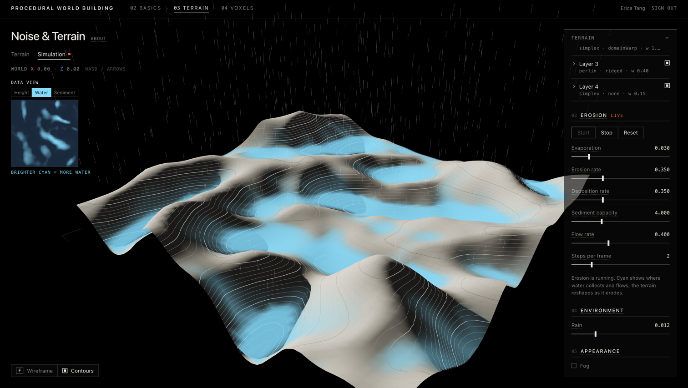
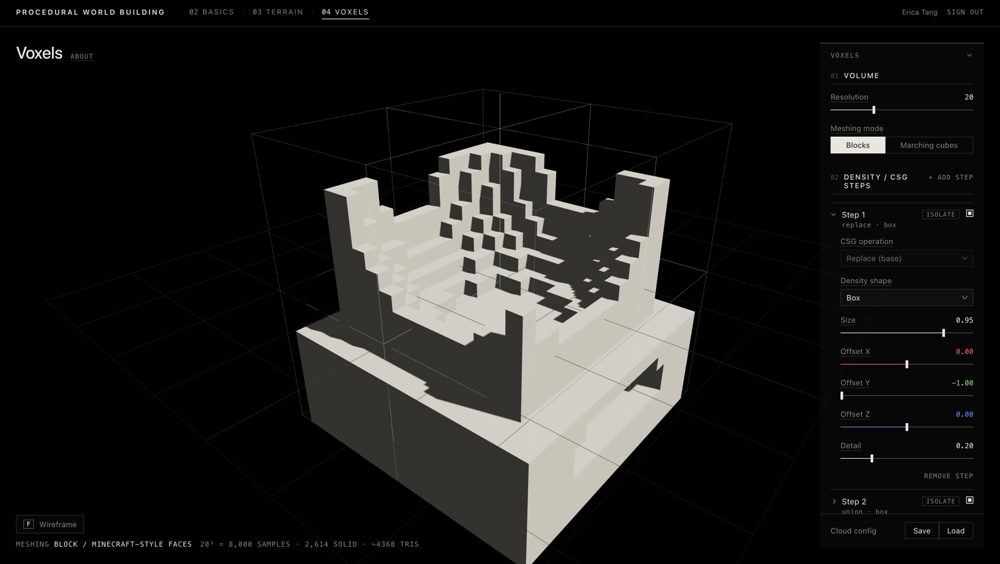
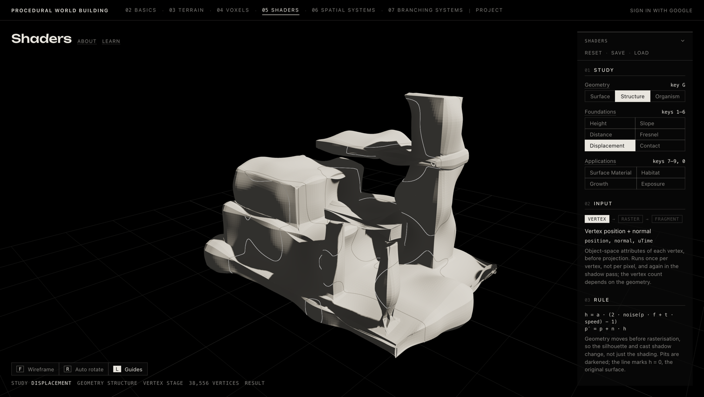
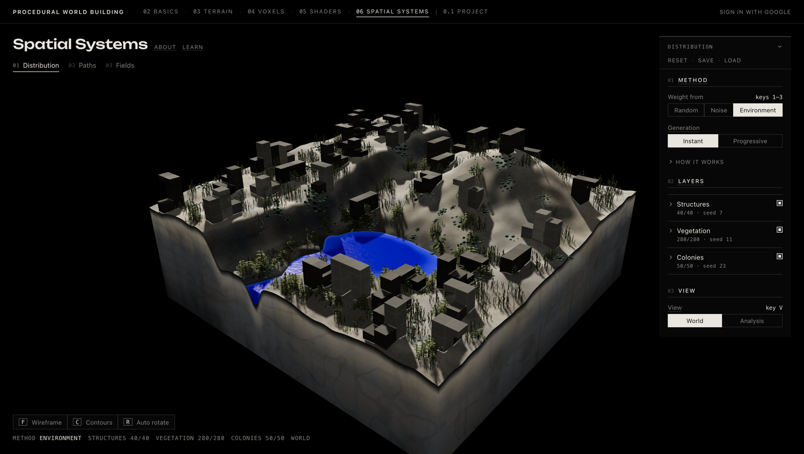
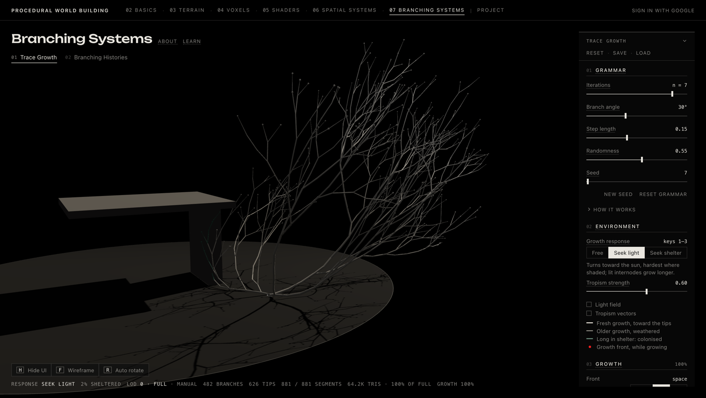
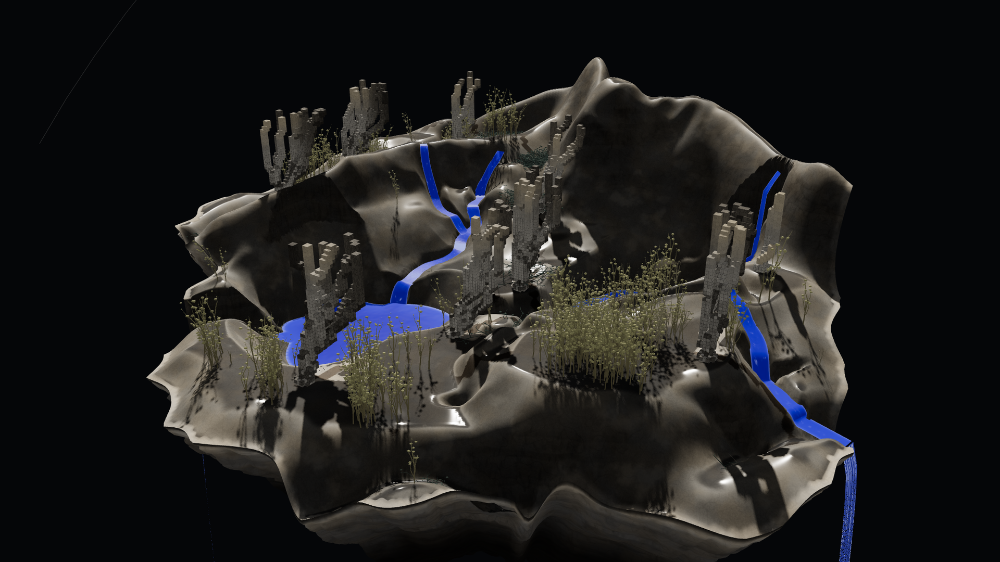

# Procedural World Building

A study notebook for a semester of procedural world building in the browser: weekly exercises in Three.js, noise, voxels, shaders and spatial systems, leading into one main project, **Shadow Ecology**.

**Live Demo:** [procedural-world-lab.web.app](https://procedural-world-lab.web.app)

## Contents

- [Weekly Exercises](#weekly-exercises)
  - [Selected Studies](#selected-studies)
- [Main Project — Shadow Ecology](#main-project--shadow-ecology)
- [Repository Structure](#repository-structure)
- [Running Locally](#running-locally)

---

## Weekly Exercises

One page per week in the app, and one tutorial per week in [`docs/tutorials/`](docs/tutorials/).

| Week | Topic | Key concepts | Notes |
| --- | --- | --- | --- |
| 02 | Three.js Basics | Node, Vite and React setup · scene, camera, geometry, material, light · orbit controls | [Install and Run React](docs/tutorials/02-installing-react.md) |
| 03 | Procedural Terrain | Value, Perlin, simplex and cellular noise · octaves · ridged, billow, terracing and domain-warp shaping · heightmaps · hydraulic erosion and water | [Noise and Terrain](docs/tutorials/03-procedural-noise-and-terrain.md) |
| 04 | Voxels & Firebase | Density fields · CSG (union, subtract, intersect) · Blocks vs Marching Cubes · chunks · Google sign-in, Firestore snapshots, Hosting | [Voxels](docs/tutorials/04-01-voxels.md) · [Firebase](docs/tutorials/04-02-firebase.md) |
| 05 | Shaders | Vertex and fragment stages · uniforms, attributes and varyings · fields and terms on three specimens · displacement | [Shaders](docs/tutorials/05-shaders.md) |
| 06 | Spatial Systems | Seeded candidates, valid ground and weighted draws · Random, Noise and Environment weights · spanner networks, downhill flow and branching growth · terrain-steered wind field, particles and exposure | [Spatial Systems](docs/tutorials/06-spatial-systems.md) |
| 07 | Branching Systems | Stochastic L-systems and a 3D turtle · Free, Seek light and Seek shelter · growth through time · Full / Reduced / Skeleton LOD · one world branching into five histories · gated events and persistent traces | [Branching Systems](docs/tutorials/07-branching-systems.md) |

Before Week 02: [Git and GitHub for Beginners](docs/tutorials/01-git-and-github.md) (Week 01). New notes start from the [tutorial template](docs/tutorials/_template.md).

### Selected Studies

| Week 03 — Erosion | Week 04 — Voxels | Week 05 — Shaders | Week 06 — Spatial Systems | Week 07 — Branching Systems |
| --- | --- | --- | --- | --- |
| [](docs/tutorials/03-procedural-noise-and-terrain.md) | [](docs/tutorials/04-01-voxels.md) | [](docs/tutorials/05-shaders.md) | [](docs/tutorials/06-spatial-systems.md) | [](docs/tutorials/07-branching-systems.md) |
| Rain carves the heightmap; water settles where it drains. | A ruin assembled from density fields and CSG steps. | A vertex shader pushes the surface along noise. | Three layers scattered by the ground each one prefers. | One grammar, three ways of answering the light. |

---

## Main Project — Shadow Ecology

### Shadow Ecology 0.2

A procedural world where environmental processes leave traces over time.

**Core causal loop**

```text
Light → Growth → Structure → Shadow → Habitat → Trace → Future World
```



- **Terrain and water.** Layered noise shapes ridges, valleys and basins; drainage gathers into rivers, lakes and waterfalls.
- **Architecture.** Voxel structures grow through local decisions about light, support, connection and structural risk, then age, fail and fall as rubble.
- **Ecology.** Light-seeking and shadow-seeking vegetation each settle where conditions suit them, so the shade of architecture reshapes where life grows.
- **Paths and traces.** Repeated simulated trips wear routes into the terrain, and worn paths are easier to reuse, so they reinforce themselves.
- **Weather and material memory.** Rain, wind and fog change the world, and wetness, staining and weathering stay visible after the weather has passed.
- **Ways of Seeing and history.** World, Architecture and Habitat read the same state in different ways; the Observation Lens slows time locally to show processes up close; Parallel Worlds shows how one shared past diverges under different disturbances.

#### Timelapse

**Timelapse:** [Shadow Ecology evolving through several simulated days](docs/media/project/shadow-ecology-02-timelapse.mp4) (MP4, 24 s).

### Prototype 0.1

The first prototype established the original relationship: architecture grows toward light, its shadow accumulates as shelter, and remembered shelter becomes habitat.

### References

- Concept, rules and known gaps: [Shadow Ecology planning](docs/planning/shadow-ecology.md)
- Visual direction: [Style Guide](STYLE-GUIDE.md)
- Code: [`app/src/project02/`](app/src/project02/) (0.2) · [`app/src/project/`](app/src/project/) (0.1)

---

## Repository Structure

```text
app/                   Vite + React + TypeScript + Three.js (React Three Fiber)
  src/weeks/week02–07  Weekly exercise pages
  src/project02/       Shadow Ecology 0.2
  src/project/         Shadow Ecology 0.1 prototype
  src/shared/          Noise, shaders, snapshot persistence, UI system
docs/
  tutorials/           Weekly study notes (Week 01–07) and template
  analysis/            Experiments, observations and critique
  planning/            Shadow Ecology plan and early backlog
  images/              Weekly, README and project screenshots
  media/
    project/           Shadow Ecology video media
STYLE-GUIDE.md         Visual language for the lab
firebase.json          Hosting (target: lab) and Firestore config
firestore.rules        Per-user snapshot rules
```

## Running Locally

```bash
cd app
npm install
npm run dev
```

Open the URL Vite prints (usually `http://localhost:5173`). Signing in and Save / Load snapshots need Firebase keys in `app/.env.local`; copy `app/.env.example` and see [Firebase](docs/tutorials/04-02-firebase.md). Everything else works without them.
