# Shadow Ecology

A procedural island grown from one seed: structures rise toward the light, and the shade they cast decides who can live where.

<p align="center">
  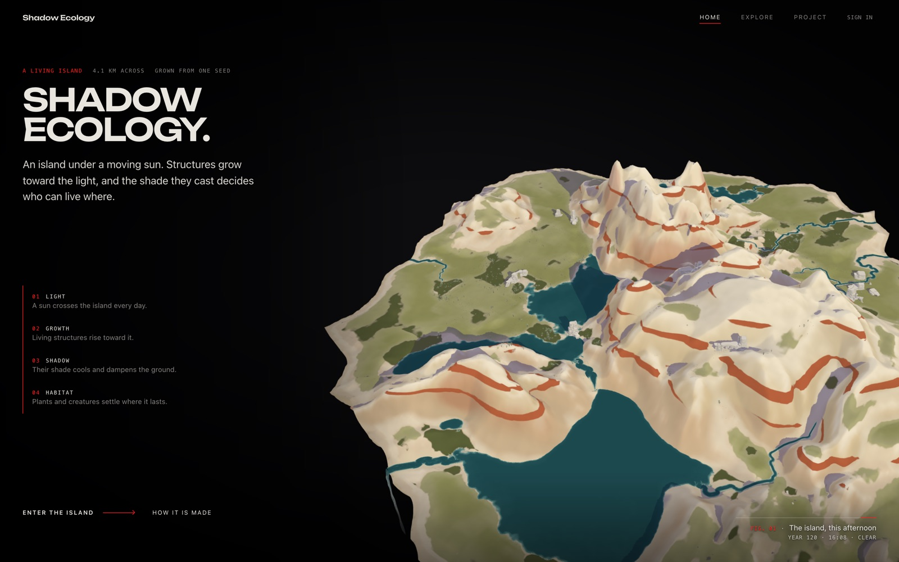
</p>

**Live website:** [https://procedural-world-lab.web.app/](https://procedural-world-lab.web.app/)

An island under a moving sun. Living architecture grows toward that light; lasting shade cools and dampens the ground; plants and creatures settle where it holds.

```text
Light → Growth → Structure → Shadow → Habitat
```

---

## World Formation

How the island is generated—stage by stage—from terrain and water through sunlight, living architecture, and vegetation.

<p align="center">
  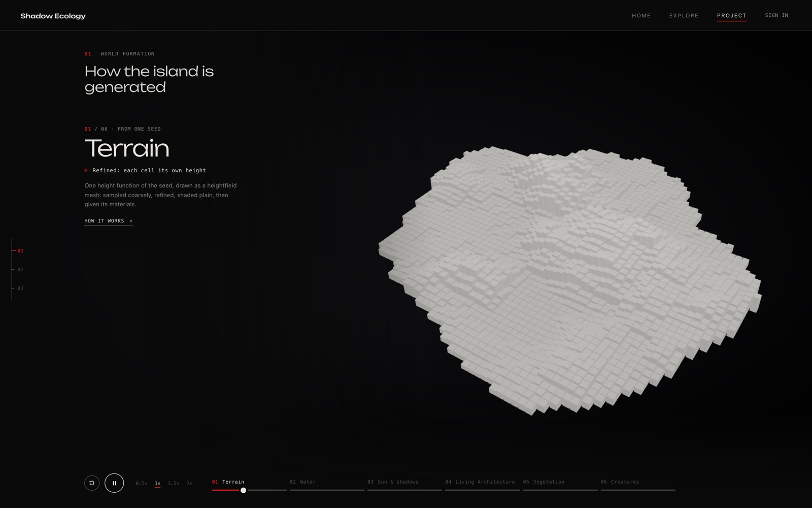
  &nbsp;
  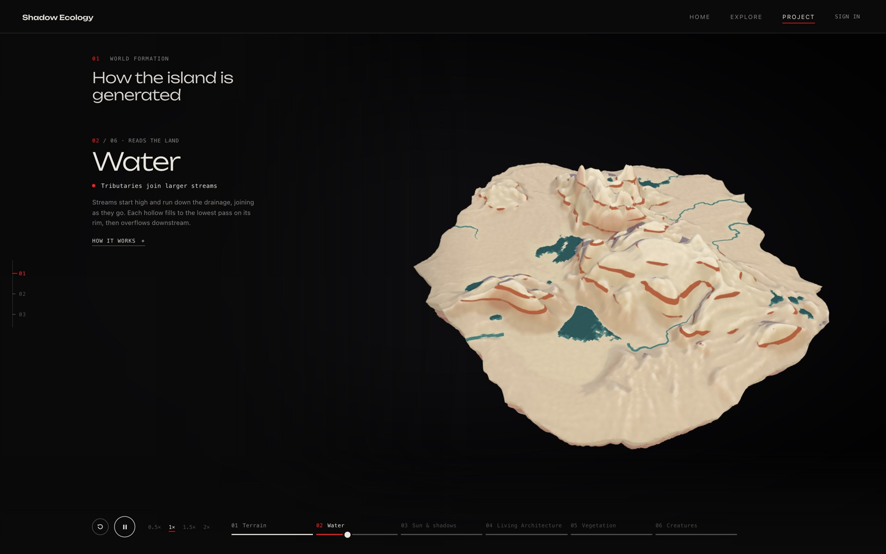
</p>
<p align="center">
  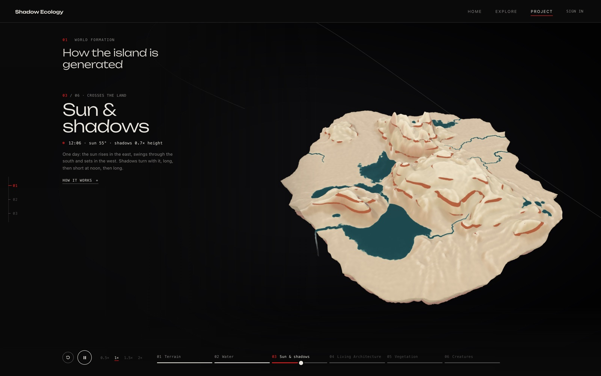
  &nbsp;
  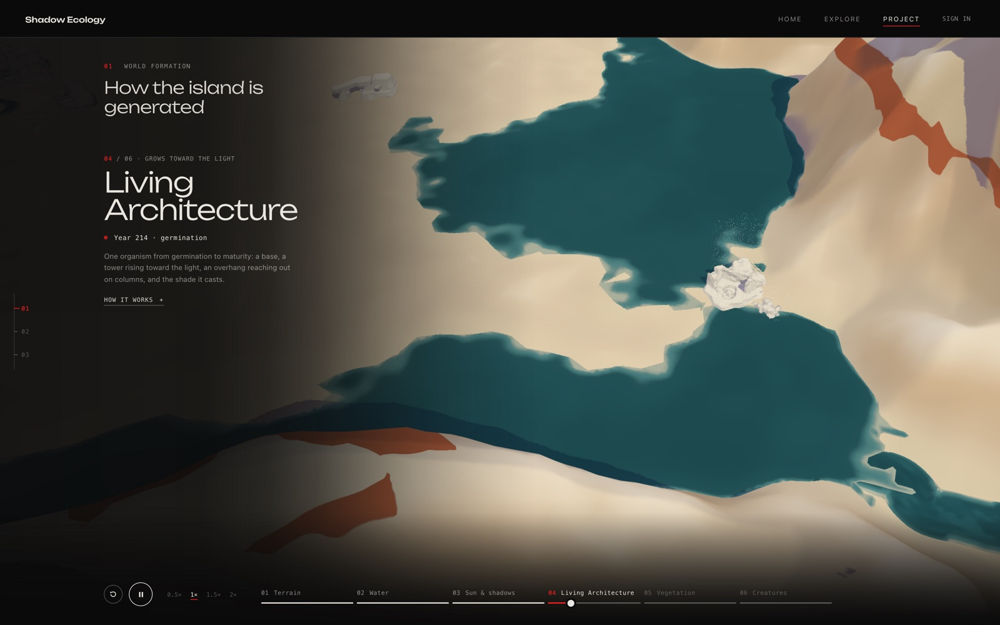
</p>
<p align="center">
  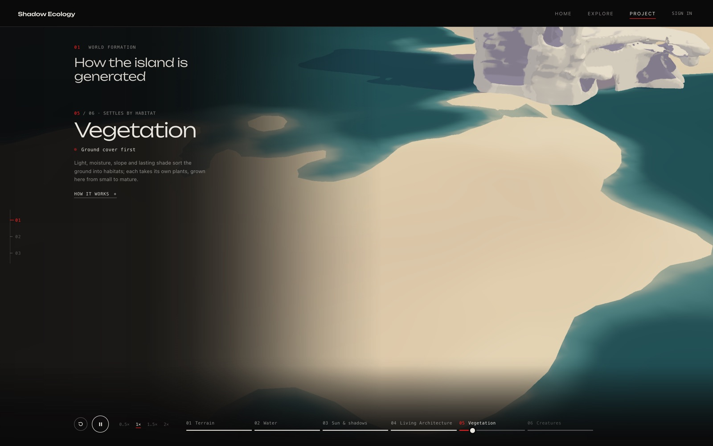
</p>

---

## World Anatomy

Technical exhibits that open the live world’s own data: why the land has this shape, where water flows, how structures take form, and why plants grow in some places and not others.

<p align="center">
  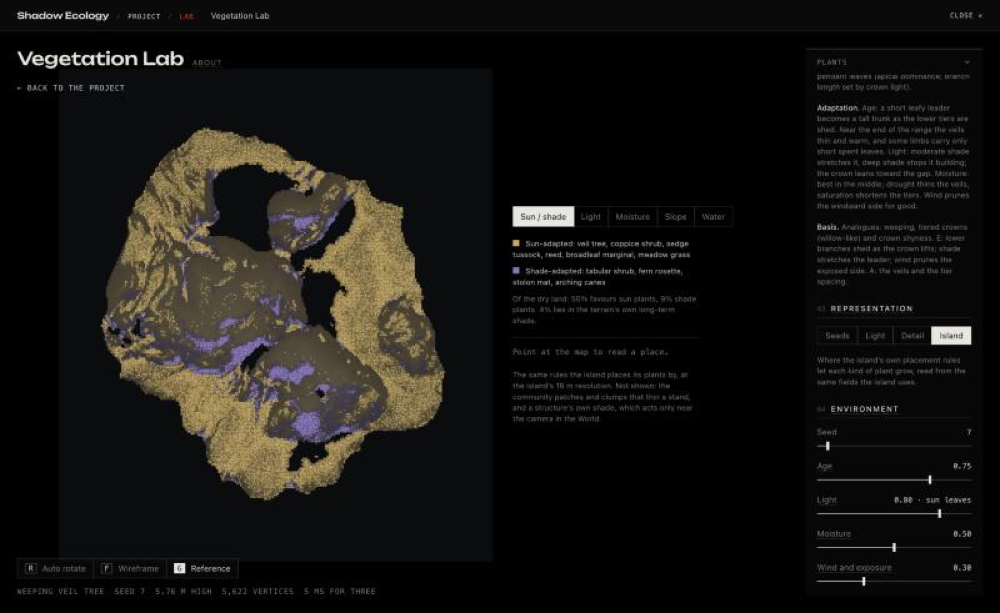
</p>

Light, moisture, slope, and lasting shade sort the ground into habitats—the same fields that place architecture, plants, and creatures on the island.

---

## Explore the Island

Orbit the whole island, approach its shores, or walk the ground. Change time of day, open environmental lenses, and use the field camera to frame what you find.

<p align="center">
  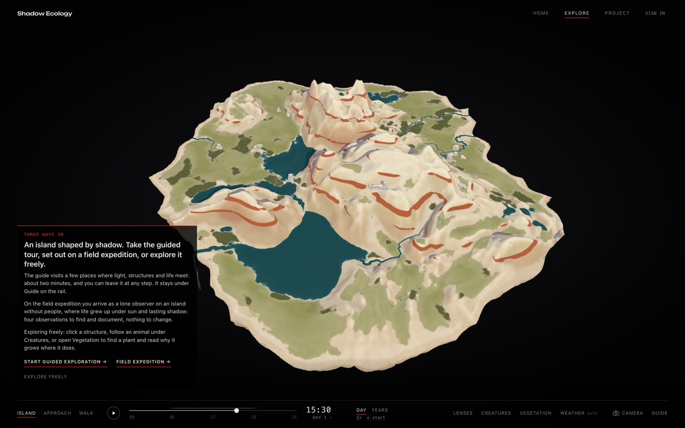
</p>
<p align="center">
  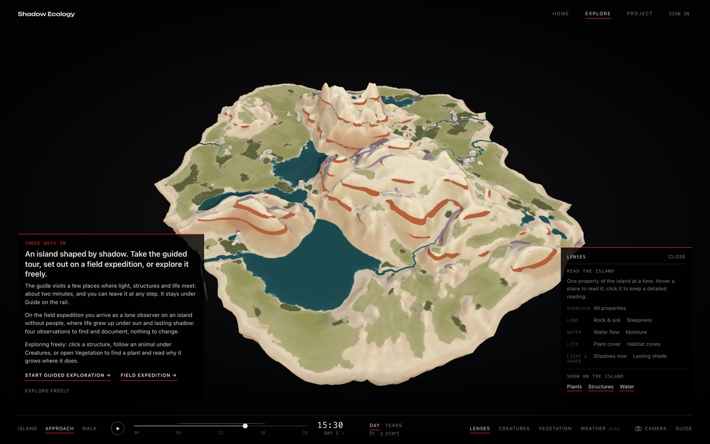
  &nbsp;
  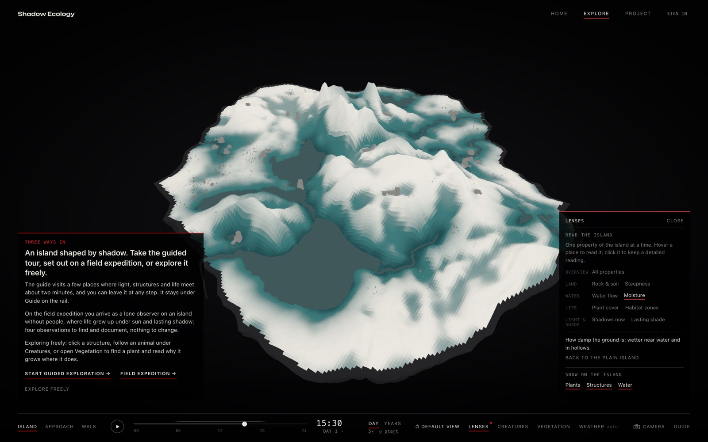
</p>
<p align="center">
  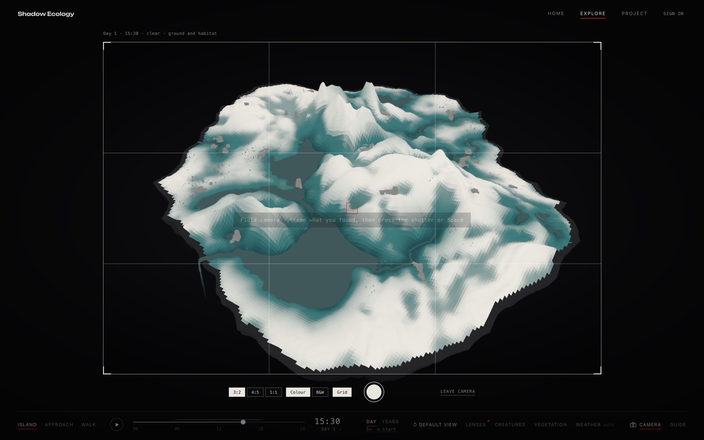
</p>

| Experience | What you meet |
| --- | --- |
| **Home** | The island as a specimen: title, idea, and a still afternoon view. |
| **World Formation** | Terrain, water, sun and shadows, architecture, vegetation, creatures—replayed stage by stage. |
| **World Anatomy** | Exhibits drawn from the live world’s own data. |
| **Explore** | Island, Approach, and Walk; time, lenses, weather, and life. |
| **Field Expedition** | A lone-observer mode for documenting places and finds (still taking shape). |
| **Labs** | Architecture, Vegetation, Creature, and Habitat studies opened from Project. |

---

## Under the Hood

**Procedural systems**

- **Terrain** — layered noise for massifs, ridges, hills, drainage, and surface grain across a 4.1 km island.
- **Hydrology** — drainage into rivers, lakes, and shores that reshape ground and habitat.
- **Light and shadow** — a daily sun; temporary shade from lighting, lasting shelter read as habitat over time.
- **Living architecture** — sessile structures that grow toward light and moisture and shelter what settles beneath them.
- **Vegetation** — plant communities placed by habitat, moisture, and shade.
- **Creatures** — body plans and behaviours that read the same environmental fields.

**Stack:** React · TypeScript · Vite · Three.js · React Three Fiber · Firebase (Auth, Firestore, Hosting)

### Getting started

```bash
cd app
npm install
npm run dev
```

Open the URL Vite prints (usually `http://localhost:5173`). The site opens at `/` (Home). Sign-in and saved Explore views need Firebase keys in `app/.env.local`—copy `app/.env.example` and see [Firebase notes](docs/tutorials/04-02-firebase.md). Everything else runs without them.

### Course exercises

Weekly experiments that led into Shadow Ecology. Each has a page in the app (`/open/week02`–`week08` from Project) and a tutorial in [`docs/tutorials/`](docs/tutorials/).

| Week | Topic | Notes |
| --- | --- | --- |
| 02 | Three.js Basics | [Install and Run React](docs/tutorials/02-installing-react.md) |
| 03 | Procedural Terrain | [Noise and Terrain](docs/tutorials/03-procedural-noise-and-terrain.md) |
| 04 | Voxels & Firebase | [Voxels](docs/tutorials/04-01-voxels.md) · [Firebase](docs/tutorials/04-02-firebase.md) |
| 05 | Shaders | [Shaders](docs/tutorials/05-shaders.md) |
| 06 | Spatial Systems | [Spatial Systems](docs/tutorials/06-spatial-systems.md) |
| 07 | Branching Systems | [Branching Systems](docs/tutorials/07-branching-systems.md) |
| 08 | Agents & Scale | [Agents & Scale](docs/tutorials/08-agents-and-scale.md) |

Before Week 02: [Git and GitHub](docs/tutorials/01-git-and-github.md).

### Documentation

- [Documentation index](docs/README.md)
- [Shadow Ecology planning](docs/planning/shadow-ecology.md) — concept, systems, and history
- [Visual direction](docs/planning/shadow-ecology-visual-direction.md)
- [Living Architecture experiments](docs/analysis/living-architecture-experiments.md)
- [Style guide](STYLE-GUIDE.md)
