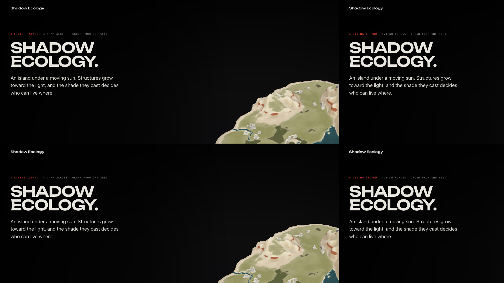
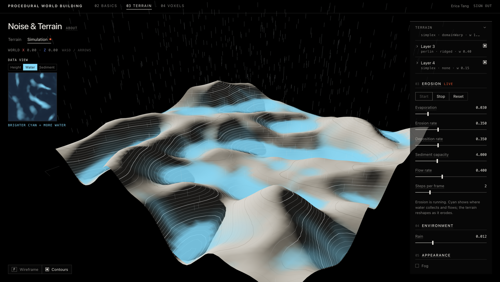
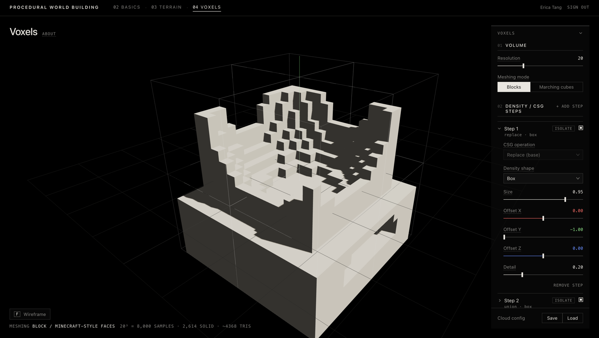
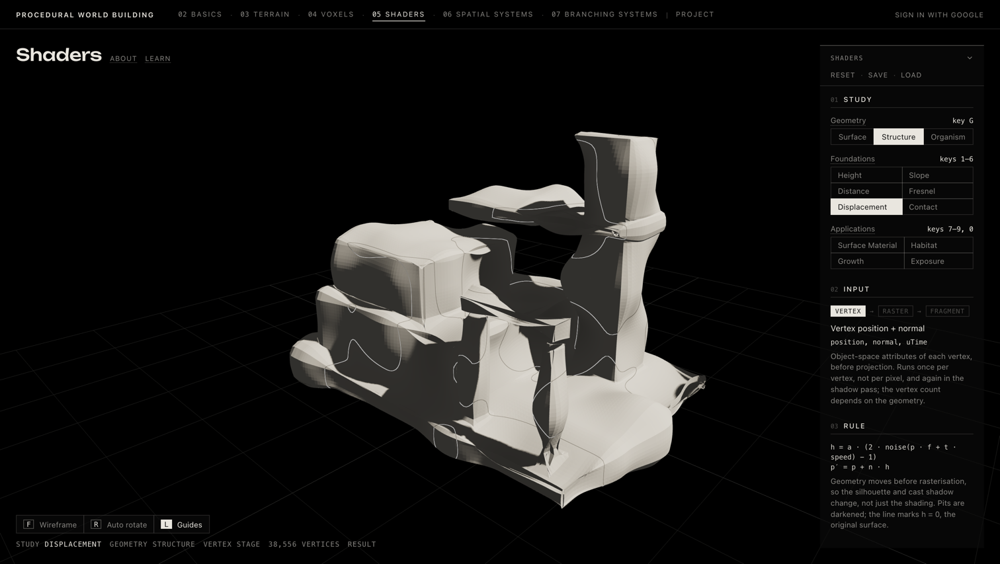

# Shadow Ecology

A procedural island grown from one seed: structures rise toward the light, and the shade they cast decides who can live where.



**Live website:** [https://procedural-world-lab.web.app/](https://procedural-world-lab.web.app/)

---

## Overview

Shadow Ecology is a browser-based world where environmental processes leave visible traces. A moving sun lights the terrain; living architecture grows toward that light; lasting shade becomes habitat for plants and creatures. The project asks how a procedural system can feel precise, strange, and alive—readable from afar, richer when inspected closely.

```text
Light → Growth → Structure → Shadow → Habitat
```

Built with React, TypeScript, Three.js, and Vite, and developed through a semester of weekly procedural studies that feed the same island.

---

## Explore the world

| Experience | What you meet |
| --- | --- |
| **Home** | The island as a specimen: title, idea, and a still afternoon view. |
| **World Formation** | How the island is generated—terrain, water, sun and shadows, architecture, vegetation, creatures—stage by stage. |
| **World Anatomy** | Technical exhibits drawn from the live world’s own data. |
| **Explore** | Orbit, approach, or walk the island; change time, lenses, weather, and life. |
| **Field Expedition** | A lone-observer mode for documenting places and finds (still taking shape). |
| **Labs** | Architecture, Vegetation, Creature, and Habitat studies opened from Project. |

Earlier prototypes (0.1 and 0.2) and the weekly exercises remain reachable from the Project page.

---

## Procedural systems

- **Terrain** — layered noise for massifs, ridges, hills, drainage, and surface grain across a 4.1 km island.
- **Hydrology** — drainage into rivers, lakes, and shores that reshape ground and habitat.
- **Light and shadow** — a daily sun; temporary shade from lighting, lasting shelter read as habitat over time.
- **Living architecture** — sessile, mineralizing structures that grow toward light and moisture and shelter what settles beneath them.
- **Vegetation** — plant communities placed by habitat, moisture, and shade.
- **Creatures** — body plans and behaviours that read the same environmental fields.

---

## Technology

React · TypeScript · Vite · Three.js · React Three Fiber · Firebase (Auth, Firestore, Hosting)

---

## Getting started

```bash
cd app
npm install
npm run dev
```

Open the URL Vite prints (usually `http://localhost:5173`). The site opens at `/` (Home). Sign-in and saved Explore views need Firebase keys in `app/.env.local`—copy `app/.env.example` and see [Firebase notes](docs/tutorials/04-02-firebase.md). Everything else runs without them.

---

## Course exercises

Weekly experiments that led into Shadow Ecology. Each has a page in the app (`/open/week02`–`week08` from Project) and a tutorial in [`docs/tutorials/`](docs/tutorials/).

| Week | Topic | Notes |
| --- | --- | --- |
| 02 | Three.js Basics | [Install and Run React](docs/tutorials/02-installing-react.md) |
| 03 | Procedural Terrain | [Noise and Terrain](docs/tutorials/03-procedural-noise-and-terrain.md) |
| 04 | Voxels & Firebase | [Voxels](docs/tutorials/04-01-voxels.md) · [Firebase](docs/tutorials/04-02-firebase.md) |
| 05 | Shaders | [Shaders](docs/tutorials/05-shaders.md) |
| 06 | Spatial Systems | [Spatial Systems](docs/tutorials/06-spatial-systems.md) |
| 07 | Branching Systems | [Branching Systems](docs/tutorials/07-branching-systems.md) |
| 08 | Agents & Scale | [Agents & Scale](docs/tutorials/08-agents-and-scale.md) |

Before Week 02: [Git and GitHub](docs/tutorials/01-git-and-github.md).

| Week 03 | Week 04 | Week 05 | Week 06 | Week 07 |
| --- | --- | --- | --- | --- |
| [](docs/tutorials/03-procedural-noise-and-terrain.md) | [](docs/tutorials/04-01-voxels.md) | [](docs/tutorials/05-shaders.md) | [](docs/tutorials/06-spatial-systems.md) | [](docs/tutorials/07-branching-systems.md) |

---

## Documentation

- [Documentation index](docs/README.md)
- [Shadow Ecology planning](docs/planning/shadow-ecology.md) — concept, systems, and history
- [Visual direction](docs/planning/shadow-ecology-visual-direction.md)
- [Living Architecture experiments](docs/analysis/living-architecture-experiments.md)
- [Style guide](STYLE-GUIDE.md)
