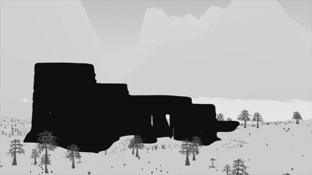
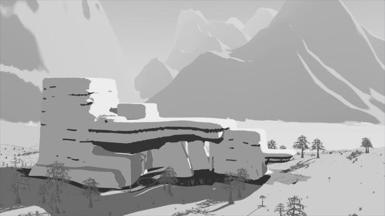
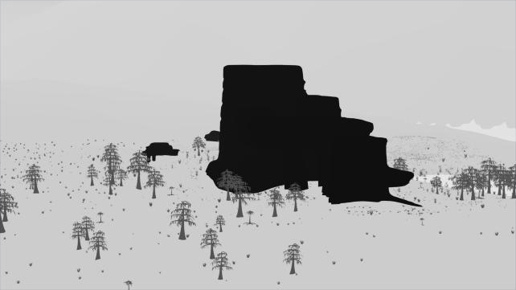
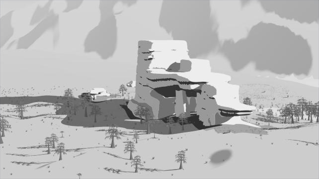
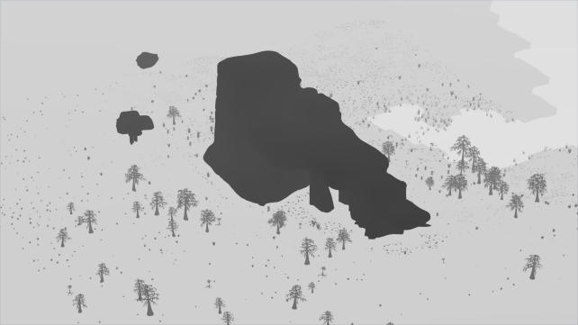
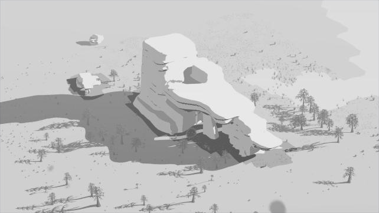
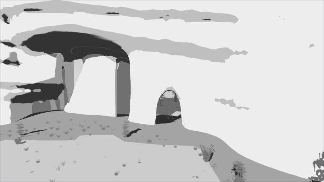
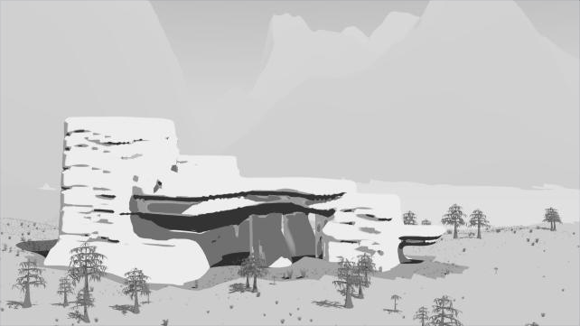
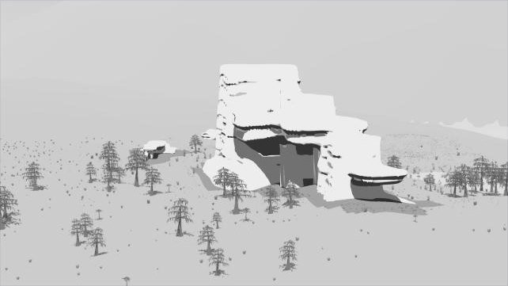

# Composition & Silhouette Study 01

> Stage 1 of the [Art Direction reset](../planning/shadow-ecology-art-direction-brief.md). Evaluates framing, proportion, silhouette, foreground/background and negative space **before** any change to geometry, colour, line or texture.
> Where: Labs → Habitat Study → **C · Compose**. Code: `app/src/habitat-study/compose/` (reads the study site only; nothing in `project03/` or styles A/B/B2 changed).

## How to read the plates

- **Silhouette:** one flat grey per kind of thing. Architecture is black, plants dark grey, ground light, sky white. This tests shapes only.
- **Values:** four steps from the light. **Lit**, **turned** (the face looks away from the sun), **cast** (the sun is blocked) and **deep** (persistent shade: under the roof, the undersides of shelves). Each kind keeps its own range, so masses still separate.
- **Same conditions everywhere:** a 16:9 plate, the same geometry, and every camera anchored to the sun at 16:30. Changing the hour moves the light, not the camera, so 16:30 and 11:00 compare like for like.
- **Tools:** *Sheet* shows the structure from 12 sides at once (low / mid / high). *Squint* (S) blurs the plate. *Guides* (G) shows the thirds. *Clean* (F) hides the page heading.

The Reference Overhang turns out to be **~120 m across** (its bounding radius is 61 m). That's the single most important number in this study.

---

## The plates (16:30 unless noted)

| | Silhouette | Values |
|---|---|---|
| **H1 · Profile** low, close, half into the sun |  |  |
| **H2 · Side light** sun from the side, structure on the right third |  |  |
| **H3 · Elevated** high, far, very long lens |  |  |

| Under the roof (values) | H1 at 11:00 (control) | H2 at 11:00 (control) |
|---|---|---|
|  |  |  |

Contact sheets used to find the framings: [low, silhouette](../images/project/composition-study/sheet-low-silhouette.png) · [mid, values](../images/project/composition-study/sheet-mid-values.jpg)

---

## Findings

### 1. The silhouette reads as a ruined fortress, not an organism
In silhouette (H1), the structure is a **flat-topped keep plus a long rectilinear wall with window-like openings**. Every outline is a vertical wall or a level roof. There's no taper, no thin edge, no reach, and no curve at the scale of the whole form. The openings under the shelf read as arches and windows, the "human-designed doors and windows" the brief rules out. From above (H3) it's a **potato-shaped footprint**.

The elegant moments already exist, but they're small:
- the thin, raking pier blade (H2, lower right of the silhouette);
- the gap of sky under the great shelf (H1, sheet at 0° and 330°);
- the drooping lip of the lower shelf.

**Implication for the geometry stage:** this isn't about sharper edges. The **profile** has to change. The roofline needs to be broken, shelves should thin and lift (or droop) toward their growth edge, the keep should taper or be undercut, and the **one large span with a big void beneath it** should become the hero, instead of several small openings.

### 2. Scale: the structure is a landform, the plants are texture
At 120 m wide and ~35 m tall, the overhang is closer to a mesa than a building, and the 5–10 m trees become **speckle**. In every silhouette the plants are the noisiest element: evenly scattered, all the same, and their branching form reads as **bare winter trees**. We need to decide whether plants act as *scale figures* (few, placed, readable) or as *masses* (grouped into shapes). Right now they're neither.

### 3. Lit stone and sky have the same value
In front-lit and side-lit views, the lit architecture (≈0.93) sits almost at the value of the horizon sky (≈0.85), so the structure **dissolves into the sky** (H1 at 11:00, the 0°/300°/330° cells of the sheets). The structure holds only:
- when **contre-jour** puts its face into shadow (H1 at 16:30);
- when it stands **against the mountain** (H1);
- when seen **from above against the ground** (H3).

**Implication for the colour stage:** the sky must sit clearly darker (or more saturated) than lit stone, or the hero has to rely on contre-jour.

### 4. A hero framing implies a hero hour
H1 is the strongest plate at 16:30 and the weakest at 11:00 (flat, front-lit, white on white). Composition and light can't be judged apart here. **The hero composition is H1 *at late afternoon*.** It also raises a design question: the great shelf grows toward the light, so for most of the day we look at its lit side. Should the hero face be the *shade* side?

### 5. The background works; the foreground is empty
The mountain behind H1 gives a strong second plane and a bright horizon band, which is real depth. But:
- **Background noise:** distant slopes break into blotchy turned/lit patches (H2 sky area). The rendering stage should flatten distant values more (aerial perspective) than physical lighting does.
- **Empty foreground:** every exterior plate's lower third is open ground with scattered trees. Nothing frames the subject. That's partly a limit of the study window (plants exist only within 130 m of the site centre), partly a missing decision: the brief's "dark foreground framing" isn't there.

### 6. Under the roof is the strongest *place*, but the most confused picture
It has enclosure, a ceiling, the undercroft as the darkest shape, and a view out. But at 16:30 the low sun shines straight in, so the walls that should be the darkest read as white, and the openings read as arched windows. This plate needs the persistent-shade treatment (stage 2/3) and probably a lower ceiling or a narrower, deeper opening.

---

## Recommendation

- **Primary hero: H1 · Profile at 16:30.** Layered horizontals in contre-jour, the mountain as backdrop, a bright horizon band, and a clear figure–ground. Its weakness is the silhouette itself (finding 1), which is exactly what the geometry stage should fix, so it's also the best plate to judge that work against.
- **Secondary: H3 · Elevated.** The cast shadow becomes a shape of its own, which makes it the best plate for judging *shadow as habitat*.
- **Close view: Under the roof.** This is where shade has to read as a place.
- **Drop H2** as a hero (it's a block on a field) but keep it as a control.

## Open questions for you

1. **Foreground before geometry?** I can add a deliberate foreground to H1 (the second structure, a ledge, or a massed plant group cut by the frame edge) as one more composition step, or move straight to geometry with H1 / H3 / Under as the fixed comparison plates. I'd move to geometry. The silhouette is now what limits the composition, and a foreground can't fix a fortress outline.
2. **Scale:** keep the overhang at landform scale (~120 m, mesa-like, with plants as texture) or test it at roughly half size, where plants and structure relate as a garden and a building? This changes the whole character, so it should be decided before the geometry work.
3. **Hero face:** lit side or shade side?
