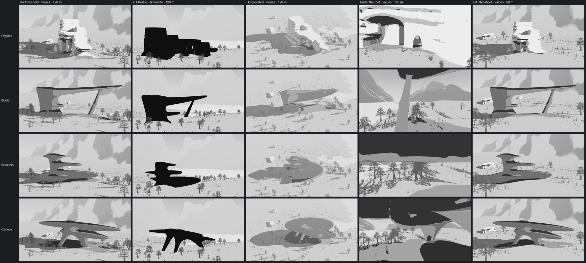

# Geometry & Silhouette Study 01

> Stage 2 of the [Art Direction reset](../planning/shadow-ecology-art-direction-brief.md), after [Composition Study 01](composition-study-01.md). Three new forms for the Reference Overhang, compared with the original at two scales, under identical cameras and light. No colour, line or texture yet.
> Where: Labs → Habitat Study → **C · Compose** → *Form* and *Scale*. Code: `app/src/habitat-study/compose/forms.ts`. The world's generator, styles A/B/B2 and the simulation are unchanged.
>
> **Correction (Volume Study 01).** The new forms' normals were inverted when these plates were made (a mirrored local frame; fixed since). The silhouettes and findings about outline are unaffected. In the *Values* plates of Blade, Brackets and Canopy, lit and turned faces were swapped, so read them for shape only. See [Volume Study 01](volume-study-01.md).

## How the comparison is set up

- **Same programme for every form:** one dominant mass, a shelf reaching toward the light, an undercroft beneath it. Only the *idea* of the form changes.
- **Same frame:** every form is built in one local frame. Its shelf reaches toward the 16:30 sun, and its undercroft opens toward the hero side.
- **Same cameras:** the cameras frame a fixed design envelope (~120 × 42 m), not each form's own bounds. Within a scale, every form is seen from exactly the same place. At 60 m the cameras scale with it, so a change in the picture comes from **scale relative to the land and the plants**, not from framing.
- **Plates:** four per form.
  - **H4 · Threshold** is new: it shows the lit structure and its undercroft together.
  - **H1 · Profile** in silhouette.
  - **H3 · Elevated** for the shadow as a shape.
  - **Under the roof**, now standing in each form's own shade and looking out.
- **Shade and plants follow the form:** the ground's "deep" value is computed from the new form's roof, and plants the form would stand on or roof too low are removed.
- **How the forms are made:** signed distance fields (a shape defined by how far each point is from its surface), meshed with the world's own surface-nets mesher. Each takes under a second to build.

## The forms

**Blade:** a gently waisted mass that leans back from the light. Its top falls toward the blade, so one unbroken line runs from the back of the mass out to a rounded, rising tip. A single bowed pier supports the blade, and a low ledge underneath adds a second, nearer layer of shade.

**Brackets:** a bent trunk carrying three very unequal shelf-fungus plates on its sun side. A great low plate forms a hall, with a middle and a small high plate above it. A rib down the trunk joins their roots so it reads as one body.

**Canopy:** two overlapping lens-thick leaves, the larger tilted down toward the light. They stand on three stems that are thin at the ground and flare into the roof like trumpets, one of them strongly raked.

## Findings

### Blade: the strongest single gesture, and the clearest negative space
- **Threshold:** keep, blade and pier frame **one great void**, a window of landscape inside the structure. That's the closest any form comes to Monument Valley's use of negative space as the subject.
- **Silhouette:** neither fortress nor rock. A mass and one long line.
- **From above:** a leaf with a long strip of shadow.

**Weakness:** the shade is *through* rather than *under*. The undercroft is open on both sides, so the dark band beneath the blade is thin and the "shaded place" is weak. Its other risk is reading as engineering: a modernist cantilever on a strut. The pier is the most mechanical element.

### Brackets: the richest shade, the most biological
- **Shade:** three stacked layers of shade plus a low, deep hall. The best "shade elaborates" structure: each plate makes its own micro-habitat at a different height and light level.
- **From above:** it becomes a **spiral shell**, the most beautiful plan of the three.
- **Under the roof:** a low, dark ceiling over a bright meadow, which reads as a place to be inside.

**Weakness:** the profile. A pole with plates reads as a **pagoda or a space-age tower**, and the small top plate on the trunk still gives it a "head".

### Canopy: the largest hall of shade, but the most familiar silhouette
- **Shade:** the biggest, darkest single shade shape on the ground (H3), and the stems flare elegantly in Threshold.
- **Weakness:** two round plates on stems read as a **mushroom from the side and flying saucers from above**. That's the generic read the brief warns against. The shape of the shade is strong; the object casting it is not.

### Scale: 60 m makes the shade a place; 120 m makes it a region
Because the cameras scale with the form, the two scales frame almost identically, and the only differences are the trees and the land:

- **At 120 m** the structure is a landform. Trees are texture at its foot, and the shade under it is a *region* of the map.
- **At 60 m** trees stand *inside* the undercroft and inside Blade's void (compare the two Threshold columns), and the shade becomes a *place* that plants occupy. That's what Shadow Ecology is about: life visibly living in the structure's shade.

**Recommendation: 60–80 m.** Proportions don't change, so this costs nothing in silhouette, and it lets vegetation become part of the composition. (At 60 m the original also stops dominating its window, and the mountains carry the background more.)

## Recommendation

None of the three is the answer on its own. Each solves a different part:

| | Silhouette | Negative space | Shade as a place | Biological read |
|---|---|---|---|---|
| Blade | strongest | strongest | weak (open through) | medium |
| Brackets | weak (pagoda) | medium | strongest (layered) | strongest |
| Canopy | weak (mushroom) | medium | strong (one hall) | medium |

**Proposed next iteration:** a single hybrid, **"Blade over Brackets"**:
- Blade's mass and one long rising line remain the silhouette.
- Under the blade, two or three *bracket* plates step down from the mass in its shade, so the void is still read through, but the space beneath fills with layered shade at different heights.
- Replace the straight pier with a bracket-like buttress grown from the lowest plate, so the support is part of the organism rather than a strut.

Build it at **70 m**, judge it on the same four plates, and keep Blade and Brackets beside it for comparison.

## Known limits of this study

- **Plant placement** is still the world's placement around the *original* structure (minus plants the new form displaces). Shade plants aren't re-grown under the new forms, so the undercrofts show sun-meadow plants. That's acceptable for geometry, but don't read the ecology from these plates.
- **Under the roof** plates mix the low 16:30 sun reaching in with the "deep" rule, so some interior walls read light. That gets resolved in the light and colour stage.
- **Screenshots** come from an 800 px browser pane. The study itself renders at full resolution.

## Questions for you

1. Go ahead with the **Blade over Brackets** hybrid, or keep one of the three pure forms and refine it?
2. Accept **60–80 m** as the working scale?
3. Is there one plate that should become **the** hero going forward? My suggestion is H4 · Threshold, since it shows the lit structure, its shade and the landscape through it in one frame.
