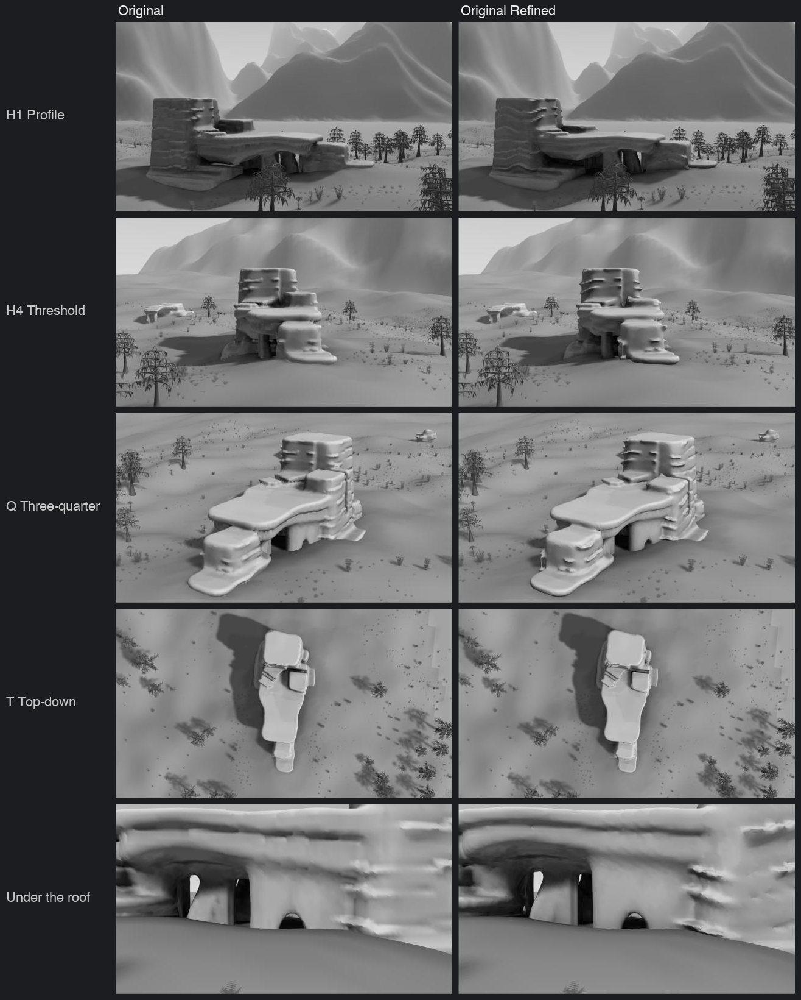
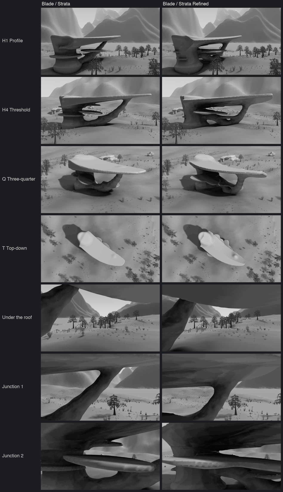
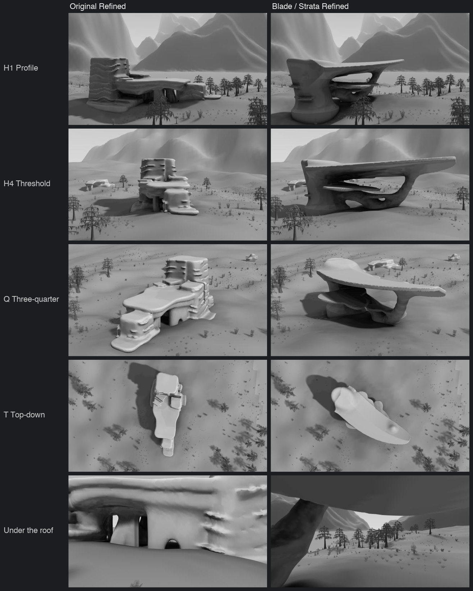

# Refinement Study 01: Original Refined and Blade / Strata Refined

> The final geometry pass of the [Art Direction reset](../planning/shadow-ecology-art-direction-brief.md), after [Volume Study 02](volume-study-02.md). Two candidates only, both at 60 m, compared in clay under the same cameras and light as before. No new concepts, materials, colour or ecology.
> Where: Labs → Habitat Study → **C · Compose** → *Original Refined*, *Blade / Strata Refined*. Every earlier form (Original, Blade, Brackets, Canopy, Fold, Strata), styles A/B/B2, the world generator and the simulation are unchanged.

## Comparisons

**Original vs Original Refined**

**Blade / Strata vs Blade / Strata Refined**

**The two candidates side by side**

---

## 1. Original Refined

### What changed

Original Refined runs the **world's own generator** (`growOverhang3`) inside the study, the same way the world grows the Reference Overhang. In the current architecture style that means seed 7, the coarse field, and the form from `refinedWorldForm`. It only adjusts options the generator **already exposes** through its `compose` setting. The generator code itself wasn't touched.

I checked that the same call **without** the adjustments reproduces the world's mesh exactly (33,051 vertices, identical bounds). So every visible difference comes from these four changes:

| Option | Change | Intent |
|---|---|---|
| `layering.lip` | ×1.7 | Interrupted ledges stand further out, so they catch light as distinct lines |
| `layering.warp` | +1.4 m | Ledge bands undulate instead of running level: geological rather than coursed |
| `tops` | middle mass ×0.9, mouth-side mass ×0.88 | The middle mass stood almost as tall as the rear one (1.16 vs 1.12). It now steps down so the rear mass leads |
| `shelfThick` | ×0.82 | The great shelf reads as a shelf, not a slab |
| `step` | ×0.72 | Finer sampling to tighten soft edges |

**A note on what I couldn't change without changing identity:** raising the rear mass's height re-rolls the generator's random sequence (it draws the strata bands up to the tallest mass), which grows a *different* organism. So hierarchy was made by lowering the others, not raising the leader.

### Assessment

- **Identity:** fully preserved, as intended. Side by side, it's clearly the same structure.
- **Ledges:** this is the clearest gain. On the rear mass (Profile, Three-quarter) the lines are more pronounced and gently wavy, so they read more like sediment and less like masonry courses.
- **Hierarchy:** better but modest. The rear mass now clearly leads in Profile and Threshold, and the middle mass reads as a step, not a twin.
- **Shelf:** slimmer, which helps a little in Profile.
- **Edges:** **barely changed.** The finer `step` has little effect because the world's version uses the coarse field, and the softness comes mostly from the generator's own wide blends. Making edges genuinely crisp would mean changing blend widths inside the generator, which this pass deliberately didn't do.
- **What remains:** the overall massing is still blocky and stacked from Three-quarter and Top-down, and still reads somewhat as a ruined fortress. Under the roof it's still the most enclosed and "architectural" space of all candidates, with arched openings that read as doors.

**Verdict:** a faithful, honest refinement. Its ceiling is set by the generator: the form improves in its *surface* (ledges), not its *structure*.

---

## 2. Blade / Strata Refined

### What changed

A new distance field (`strataRefined` in `forms.ts`). The original `strata` is untouched beside it.

- **Shelves grow from the mass.** The mass now carries three bands of **interrupted ledge lines**, which come and go around its outline (the Original's language). Each shelf leaves the mass at one of those heights, filleted at the root, so it reads as a ledge that kept growing rather than a plate slipped under the roof.
- **Shelves are irregular.** Their plans are lobed (three broad lobes and a bite), not ellipses. They're thickest at the root and thin to a crisp lip, with a thickness that wanders slightly along the rim.
- **The leg grows from the mass and meets the ground on a flared root foot.** It leaves the mass as a low arch and lands on that foot, then sweeps up and flares into the blade. Previously it lay along the ground like a bone.
- **The roof is gently creased.** It has thin lips, and the steeper facet falls away on the *far* side, so the hero edge lifts and the underside opens toward Threshold. That's the correction from Volume Study 02.
- **Normals come from the field** rather than from the mesh, to smooth shading on thin lips.

The silhouette, plan, mass and blade length are Blade's, unchanged.

### Assessment

**Gains:**
- **Threshold:** the clearest improvement of the whole geometry series. The shelves now visibly belong to the mass. The leg's low arch makes a **second, smaller opening** near the ground, so the negative space has a hierarchy: one great void, one small one.
- **Profile:** the shelves are tucked into the shadow under the blade rather than sticking out as discs. The silhouette is still Blade's long, rising gesture.
- **Three-quarter:** the leg now reads as a **root rising from the ground into the roof**, not a bone lying on it. The shelves overlap as lobed layers under the blade, and there's no saucer read.
- **Junction 2 (shelf roots):** shelves and mass are one surface. The detached-plate problem from Volume Study 02 is solved.
- **Under the roof:** a darker, lower ceiling. It feels more held than before.

**Remaining issues:**
- **Roof rim:** still shows a fine beading at the lip from Three-quarter. Field normals reduced it but didn't remove it, so it's in the geometry (grid resolution against a thin lip), not the shading. Finer meshing near edges would fix it. That's a technical fix, not a design one.
- **Roof crease:** subtle. From Top-down the roof still reads mostly as a smooth leaf. Without colour or line it barely registers. It may be enough once linework picks up the crease; if not, it can be strengthened.
- **Top-down:** the lobed shelf edges peek out along the blade's side as a ruffle, like a bracket fungus. I find this a good read, but it does add visual noise to an otherwise clean plan.
- **Busier near the ground:** the low arch plus root foot add a lot of small form there. It's richer up close but loses some of Blade's original calm in Profile.
- **Build time:** about 8–10 s in the study. Fine for review; it would need optimising before any use in the world.

**Verdict:** the stronger of the two. It meets every point of the brief except a truly crisp roof edge, which is a meshing fix.

---

## The two candidates, side by side

| | Original Refined | Blade / Strata Refined |
|---|---|---|
| **Silhouette** | recognisable, still blocky and fortress-like | distinctive, directional, unchanged from Blade |
| **Negative space** | enclosed, arch-like openings | one great void plus a smaller one, layered by shelves |
| **Structural connections** | stacked masses | continuous: mass → ledges → shelves; mass → leg → roof |
| **Thickness transitions** | uniform slabs | thick roots, thin lips, a creased roof |
| **Surface richness** | best: interrupted, warped ledges | ledges present, but sparser |
| **Under the roof** | most enclosed, reads as rooms | a held, darker canopy that opens to the landscape |
| **Relation to the world** | **already the world's generator**, so trivial to adopt | a new field: adopting it means a new generator path |

**Recommendation:** take **Blade / Strata Refined** forward as the architectural form for the art-direction work, and keep **Original Refined** as the reference for surface language (ledge rhythm and warp). The visual stage can then test whether line and texture carry the Original's richness onto Strata's structure.

One practical note: the Original is the only candidate the world can already grow. If adopting Strata in the world isn't realistic for the course timeline, Original Refined is a legitimate fallback and needs no engineering.

---

## Known limits

- Plants still come from the world's placement around the original structure (minus those each form displaces), so the ecology isn't read from these plates.
- The study's Under-the-roof camera for both Originals is the world's own ground eye (scaled to 60 m), so it faces a wall at that scale. It's the same camera as in earlier studies, kept for comparability.
- Screenshots come from a 1024 × 640 browser pane; the study renders at full resolution.

---

## For later (noted, not implemented)

You mentioned the direction after geometry. For the record, so the art-direction stage can be planned against it:

- **Shadow as a visible ecological force:** the "light simplifies, shade elaborates" principle from the brief is the natural vehicle.
- **Showing how procedural layers relate to addressable world entities** (for example, *this* shelf casts *this* shade, which supports *these* plants), rather than adding more features. The Habitat Study's site data (`shadeAt`, `ceilingAt`, per-organism geometry, plant placement) already holds most of those relationships.
