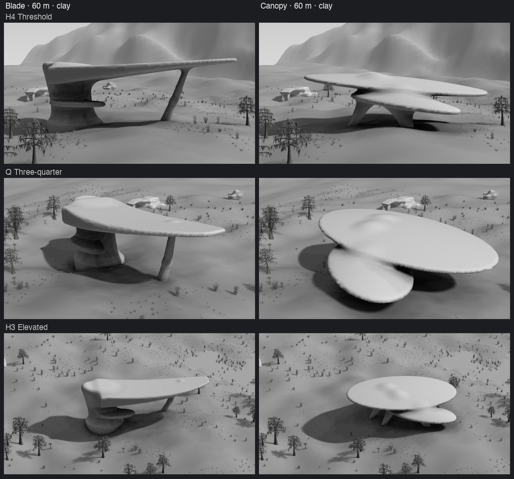
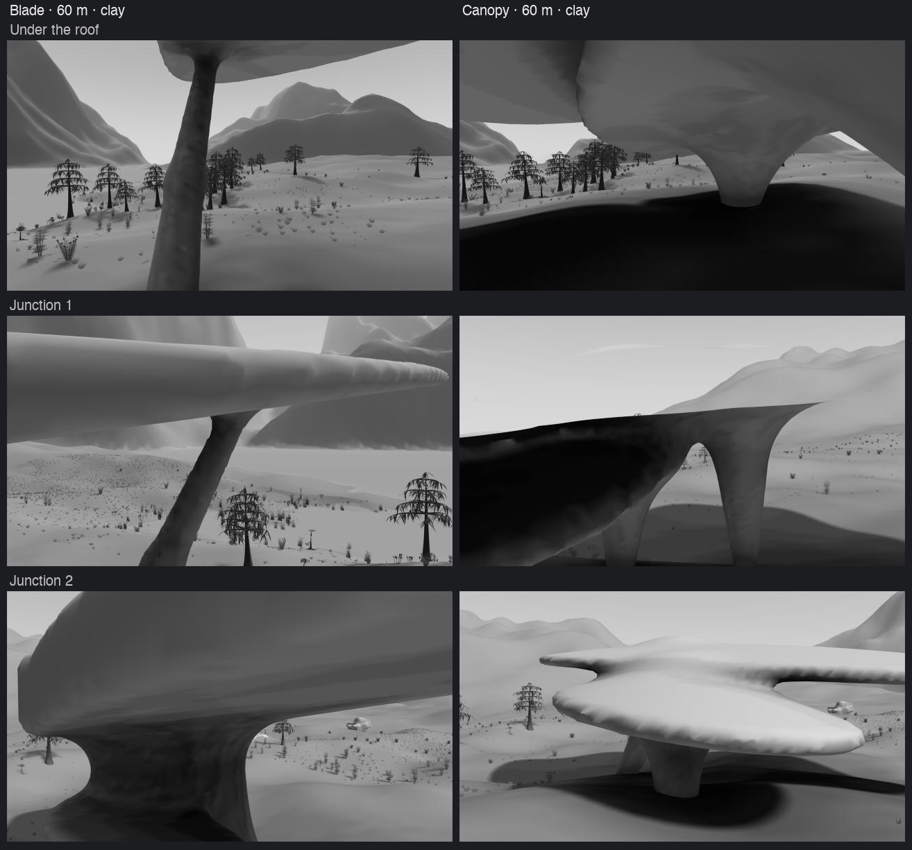
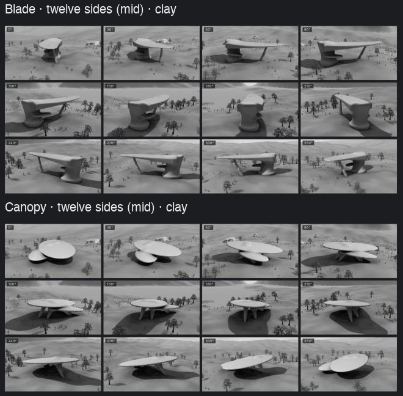

# Structure & Volume Study 01: Blade and Canopy at 60 m

> Stage 3 of the [Art Direction reset](../planning/shadow-ecology-art-direction-brief.md), after [Geometry Study 01](geometry-study-01.md). Blade and Canopy at the working scale (60 m), **geometry unchanged**, seen in a neutral clay material to judge their real three-dimensional structure. No palette, line or texture.
> Where: Labs → Habitat Study → **C · Compose** → *Clay*. Code: `app/src/habitat-study/compose/` (`notan.ts` clay mode, `forms.ts` occlusion and junction views). World generator, simulation and styles A/B/B2 unchanged.

## The clay view

- **Material:** one neutral albedo per kind. The architecture is lightest, the ground a step down, plants darker.
- **Key light:** the study sun's direction, raised to at least **38°** so the forms model in the round rather than raking. Its shadows are deliberately soft.
- **Sky fill:** falls off on faces turned downward. A little bounce from the ground lights the undersides.
- **Ambient occlusion:** baked from each form's own distance field. Rays measure how much sky a point sees past the form, plus a short cavity term that also counts the ground, so footings, junctions and the undercroft darken in proportion to how enclosed they are.
- **Same conditions for both forms:** light, hour (16:30 azimuth), scale and cameras.
- **Plates:**
  - **H4 · Threshold**.
  - **Q · Three-quarter**: new, from the hero side, a little above.
  - **H3 · Elevated**.
  - **Under the roof**.
  - **Two junction close-ups** per form, also new.
  - A **twelve-sided contact sheet** at mid height.

### A correction to Geometry Study 01

Building this view exposed a bug. The new forms are generated in a local frame that, at this site, is **mirror-handed** relative to the world. Their triangles were wound inside-out, so every normal pointed inward. It's fixed in `forms.ts`.

**Effect on the previous study:** the *silhouette* plates and findings are unaffected. In the *Values* plates of Blade, Brackets and Canopy, however, "lit" and "turned" faces were swapped. Treat those value plates as unreliable; the clay plates here are correct.

---

## Exterior: Threshold, three-quarter, elevated

## Interior and junctions: under the roof, two close-ups each

## Twelve sides

---

## Assessment

### Blade: a strong frame from the front, a table in three dimensions
- **The gesture only exists in one view.** In Threshold the mass, blade and pier draw one clear frame around the landscape. In three-quarter and from above, the "blade" is a **flat, uniformly thick slab with a pillowy rounded edge** on a pedestal. It tapers only *in plan*, never *in section*, so it's never actually thin or sharp. On the twelve-sided sheet it reads as a **desk or bench** from 120° to 240°.
- **Thickness is uniform.** Root to tip, the section is the same soft pillow. Nothing thins to an edge, thickens where load collects, or changes profile.
- **The supports are opposites:**
  - *Mass to blade* (Junction 2) is **the best moment of the form**: a continuous flare, like a stem opening into a cap, with occlusion pooling in the throat.
  - *Pier to blade* (Junction 1) is **the weakest**: a stick pushed into the underside. No flare, no transfer of load, nothing grown. It also pokes a small bump through the top surface near the tip.
- **The mass is a stack, not a body.** Foot flare, waist, a collar-like ledge, then the flare to the blade. In clay the ledge reads as a ring around a post.
- **There's barely an undercroft.** The blade is high (about 18 m) and narrow, so under it the ground is bright. The shadow it casts lands far from the structure as a separate strip. Shade isn't *held* anywhere.
- **Negative space** is excellent in three directions (through the frame) and disappears end-on.

### Canopy: a real interior, but a familiar object
- **The shade is held.** Under the roof is the darkest, most enclosed space in either form. Low ceiling, deep occlusion on the ground, a stem flaring into the roof. It's the only plate that feels like a *place to be inside*, which is what this world needs.
- **The best junction of the study.** Junction 1, from the sun side, shows two stems flaring into the underside as a **pair of pointed vaults**. Structure and roof are one surface there: grown, not assembled.
- **Thickness varies in the right direction.** It's lens-thick, heavy at the centre and thinning to the rim, so the section is more alive than Blade's.
- **But the object reads as saucers.** From three-quarter, elevated, and most of the twelve sides, two smooth discs stacked on legs. The tops are **featureless**, the largest lit areas in the picture with nothing on them.
- **The rims are inflated.** Rounded, pillowy, and slightly beaded where the 0.5 m sampling meets the thin edge (a technical artifact). The top also shows soft bumps where the stems push through.
- **Negative space** reads from the low views (the space between the stems and both plates) but closes up from above.

### What both share, and what the clay shows most clearly
1. **Everything is inflated.** Wide smooth blends and rounded slab edges give both forms a soft, marshmallow surface. There isn't a single crisp edge, flat facet or thin lip. This is exactly the "balance of sculptural curvature and deliberate planar surfaces" you asked for, and neither form has the planar half.
2. **The tops are blank.** The largest lit surface of each form carries no structure (no strata, ribs, terraces, curl or tilt you can read), so from above both are just shapes.
3. **Supports read as additions** wherever they don't flare: Blade's pier, and Canopy's stem tops showing through the roof.

### Which is stronger as a structure?
**Canopy**, clearly, in three dimensions. It has the held shade, the varying section and the vaulted junction. **Blade** has the stronger single gesture, but only from the front.

They're complementary: Canopy has the *structure* Blade lacks, and Blade has the *gesture* Canopy lacks.

## What I'd change next (for discussion, not done)

- **Combine Canopy's structural logic with Blade's direction:** one long, leaf-like roof that rises and thins toward the light, as in Blade. It would be carried by flared stems that meet it as **vaults**, as in Canopy, with the heavy end as a *cluster of stems* rather than a pedestal.
- **Give it a real section:** a crisp, thin growth edge on the sun side; a thick, heavy root where the stems gather; an underside that curves into the stems.
- **Articulate the top:** strata or growth ridges, a slight curl at the rim, so the largest lit surface has structure from above.
- **Technical fixes:** keep supports from breaking through the top surface, and sample the thin rims more finely so they don't bead.

## Questions for you

1. Do you agree **Canopy's structure** is the better foundation, with Blade's gesture brought into it? Or do you see something in Blade's 3D form worth keeping as is?
2. Is the **vaulted stem junction** (Canopy, Junction 1) the kind of structural expression you want to build on?
3. Should the next geometry pass introduce **crisp edges and articulated tops**, the planar half of the curvature/planar balance? Or explore curvature further first?
