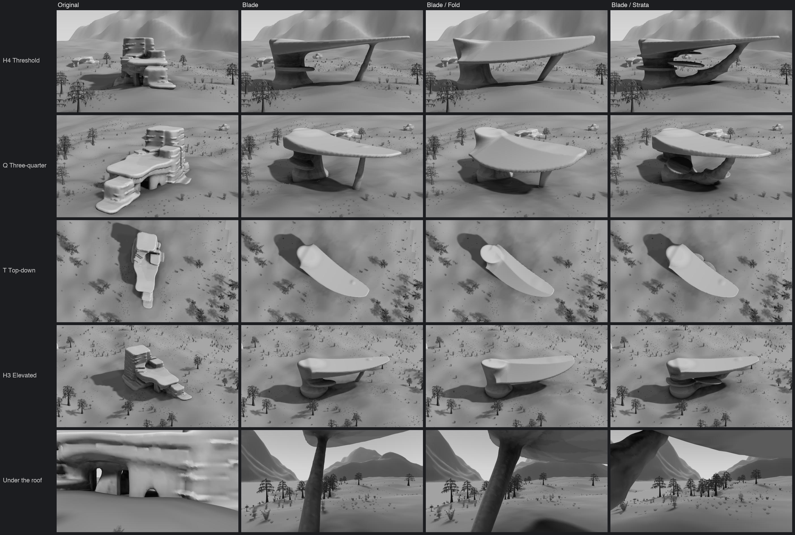
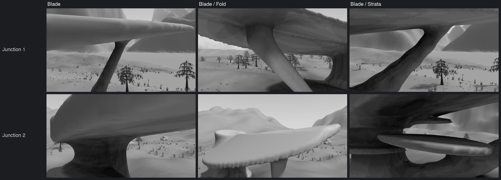
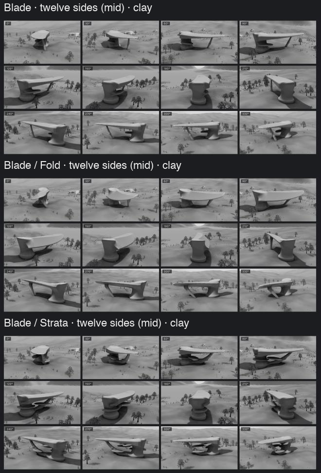

# Structure & Volume Study 02: Blade / Fold and Blade / Strata

> Stage 4 of the [Art Direction reset](../planning/shadow-ecology-art-direction-brief.md), after [Volume Study 01](volume-study-01.md). Two Blade-based variants at 60 m, compared in neutral clay against the current Blade and the Original Overhang. No materials, colour, line or ecology.
> Where: Labs → Habitat Study → **C · Compose** → *Blade / Fold*, *Blade / Strata*. Code: `app/src/habitat-study/compose/forms.ts` (`fold`, `strata`). Blade, Brackets, Canopy, styles A/B/B2, the world generator and the simulation are unchanged.

## What was built

**Blade / Fold:** Blade's mass and plan, with a new roof section and a new support.
- **Roof:** across its width, two planes meeting at a **crease**. The crease drifts from the far side at the root to the hero side at the tip. The section **twists** (banks) toward the tip.
- **Section:** thickest along the crease, thinning to **2 m lips** on both edges (1 m at 60 m). The hero side falls steeply from the crease; the far side falls gently. The underside follows the top, so the roof reads as a *folded sheet*, not a wedge.
- **Support:** the pier is replaced by **one stem**, thin at the ground and flaring wide into the underside (Canopy's vault junction).

**Blade / Strata:** Blade's mass, plan and roof, with the space beneath restructured.
- **Support grown from the mass:** a **swept leg** out of the mass's foot, low across the ground, rising to meet the blade. Mass, leg and blade form one continuous loop around the void.
- **Three unequal shelves** in the undercroft, at 6 m, 10 m and 14 m (at 60 m), on different headings and overlapping in plan. Two grow from the mass and one from the leg. Each is thick at the root with a thin lip.
- **Two partial ledges** on the mass's shaded side only, at different heights and with different reach.

**Study additions:**
- **T · Top-down** view.
- **Junction close-ups** for both variants.
- **Clay occlusion for the Original**, so it's lit the same way as the others (it has no distance field, so its mesh is made solid on a voxel grid and the bake reads that).

**Unchanged:** cameras, light (the 16:30 sun azimuth, key raised to 38°) and scale.

---

## The comparison

---

## Assessment

### The Original, seen again in clay
Its complexity is real, and it lives **in the surface**: many interrupted ledges, each catching light as a thin line, and steps of different heights. At the scale of the whole form it's still stacked blocks, and from above it's a legible but blocky stepped plan.

**What's worth carrying forward** is not its massing but its **ledge language**: thin, crisp, *discontinuous* horizontal lines that start and stop, at irregular intervals.

### Blade (baseline)
Unchanged. A strong frame in Threshold. Elsewhere, a uniform pillow slab on a stump with a stick pier. See Volume Study 01.

### Blade / Fold: the roof finally has a section, but it folds the wrong way

**Gains:**
- **First deliberate planes.** The crease divides the roof into a lit facet and a turned facet with a real edge between them. That's visible in Three-quarter and in Fold's Junction 2.
- **The twist reads from the far side.** At 240–300° on the twelve-sided sheet, the roof becomes an S-shaped wing.
- **The support is now part of the organism.** Junction 1: the thin stem opens into the underside as a vault, as Canopy's do. It's the clearest improvement over Blade's pier.

**Losses:**
- **The fold drops on the hero side.** The steep facet faces the camera and becomes a **fascia, a wall that closes the undercroft**. From 0–90° it reads as a **boat hull or ship's bow**, and the void that defined Blade shrinks in Threshold. The fold should fall away on the far side, or lift the hero edge, so the underside opens toward the viewer.
- **The lips are scalloped.** The thin edges show a regular beading: a sampling artifact of 0.4 m cells against 1 m lips with smoothed normals, not a design feature. It has to be fixed before crisp edges can be judged fairly.
- **The mass is untouched.** Still a stump that reads as a desk-end from 150–210°. From above, the crease is only a faint line on a smooth banana.

### Blade / Strata: the richest undercroft and the best connections, with a still-blank roof

**Gains:**
- **Threshold is the strongest plate of the study.** The loop of mass, leg and blade frames the void, and the shelves layer it in depth: leg in front, shelves in the middle, landscape behind. It has the Original's layered complexity, but asymmetric and sparse rather than stacked.
- **The best junctions of the study:**
  - *Junction 1:* the leg flares into the blade as a continuous vault. Support and roof are one surface.
  - *Junction 2:* the shelves make **stacked bands of shade** at different depths, the closest thing yet to a shade that "elaborates".
- **The undercroft is inhabitable.** Under the roof there's a ceiling, a wall of mass to one side and the landscape opening beyond. A room, not just a shadow.
- **The primary silhouette is preserved.** From above it's still Blade, as you asked.

**Losses:**
- **The shelves are smooth ellipses.** From Three-quarter and Elevated they read as **plates or discs slipped under a slab**, Canopy's saucer problem in miniature. They need irregular, leaf- or lobe-shaped plans, crisper lips and less uniform curvature.
- **The leg reads as a bone or root** lying on the ground from Three-quarter. That's organic, but it's the heaviest, least considered element at that angle.
- **The partial ledges read as rings**, the collar problem again. The Original does this better with thin, interrupted lines.
- **The roof is still Blade's flat pillow.** Strata didn't touch it, by design, so from above nothing has changed.
- **Technical:** it takes ~8 s to build (fine sampling plus many swept segments). Acceptable in the study; it would need optimising before it went anywhere else.

### Side by side

| | Silhouette | Volume and section | Connections | Shadow space | From many directions |
|---|---|---|---|---|---|
| **Original** | fortress | rich surface, blocky mass | stacked | arches, enclosed | blocky from all |
| **Blade** | strongest frame | uniform pillow | mass flare good, pier poor | thin, open-through | desk from 120–240° |
| **Fold** | hull from the hero side | **creased, twisted, thin lips** | **stem vault** | closed by the fascia | wing from the far side, hull from the hero side |
| **Strata** | Blade's frame, enriched | roof unchanged, shelves too smooth | **leg vault, the best** | **layered, inhabitable** | richest low; plates and bone from above |

## Recommendation (for discussion)

**Strata is the stronger foundation.** Its improvements are structural (an integrated support, a layered and inhabitable undercroft), and they hold up in the views that matter most. Fold's improvements are real but local to the roof, and its current direction costs the void.

A next pass could combine them deliberately, still in clay:
1. **Strata's structure as the base:** mass, swept leg, layered undercroft.
2. **Fold's roof section, reversed:** keep the crease, twist and thin lips, but drop the steep facet on the *far* side, so the hero edge lifts and the underside opens toward Threshold.
3. **Reshaped shelves:** irregular lobed plans, crisp lips, different thicknesses. Fewer smooth ellipses.
4. **The Original's ledge language on the mass:** thin, discontinuous lines that start and stop, instead of disc-like rings.
5. **Fix lip scalloping** (finer sampling near thin edges, or normals from the field rather than from the mesh), so edge quality can be judged.

## Questions for you

1. Do you agree that **Strata** should be the base, with **Fold's roof** brought onto it?
2. For the roof: should the steep side of the fold face **away from** the hero view (opening the undercroft), or do you like the hull-like closure from the hero side?
3. Is the Original's **interrupted ledge line** the quality you wanted to keep from it, or is there something else in its structure you'd like preserved?
