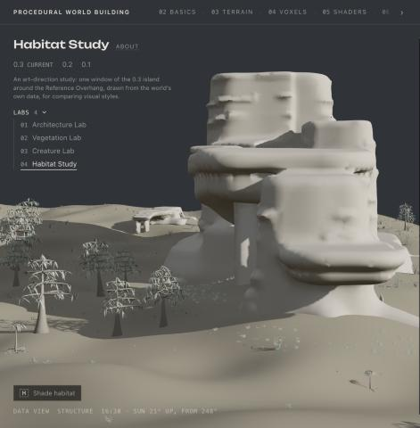
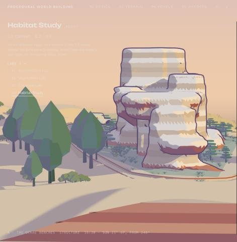
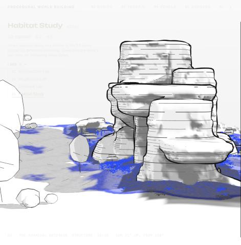

# Shadow Ecology — Art Direction Brief (reset)

> Status: **for discussion, nothing implemented.** Written 2026-11-04 after inspecting the 0.3 world and the Habitat Study lab (Data / A · Sculptural / B · Ink / B2 · Charcoal).
> Related: [Visual direction](shadow-ecology-visual-direction.md) · [Planning](shadow-ecology.md) · [Living Architecture experiments](../analysis/living-architecture-experiments.md)

Baseline screenshots (same site, 16:30): `docs/images/project/art-direction-baseline/`

| Data, Structure plate | A · Sculptural | B2 · Charcoal |
|---|---|---|
|  |  |  |

---

## 0. What exists and what can be reused

| Piece | Where | Keep? |
|---|---|---|
| **Habitat Study lab**: one 260 m window around the Reference Overhang, read from the real world (same seed, organisms, plants, shade). Fixed plate cameras (Overview, Structure, Ground, Plan) and an hour slider | `app/src/habitat-study/HabitatStudy.tsx`, `site.ts` | **Yes. This is the right sandbox.** A new direction becomes one more `Style` here, in its own folder, like `sculpt/`, `ink/`, `ink2/`. |
| **Shade habitat raster**: for each point, how much of the day's sun the structures block (`site.shadeAt`) | `site.ts`, `project03/vegHabitat.ts` | **Yes. It's the most valuable thing we have for the concept** (see §B.6). |
| Overhang geometry: a distance field (SDF) meshed with surface nets at 0.8 m, masses joined with wide `smin` blends | `project03/livingOverhang3.ts`, `livingMesh.ts` | Reuse the *layout* (keep, great shelf, outlier, undercroft). Don't reuse the *surface* as it is (§A.1). |
| Growth record on each vertex (birth, vitality, stress, light, wet) | `livingGrowth2.ts`, `livingMaterial.ts` | Yes. It's good data for driving material later. |
| Plants: 14 species, placement by habitat, Lab-grown branching geometry, 3 LODs | `project03/worldPlants.ts`, `vegetation-lab/` | Reuse the *placement*. Redesign the *forms* (§A.3). |
| Main-world styles (Contrast/Glow/Hybrid/Sculpt/Ink presets) | `project03/visualStyle.ts` | Leave alone. They're shader patches on the live world (§A.5). |
| A's ramp shader, palette-per-hour, outline shell | `habitat-study/sculpt/ramp.ts`, `palette.ts` | A good technical seed. The *idea* of a shadow hue per hour is worth keeping. |
| B2's world-space hatching with mip-blended stroke density | `habitat-study/ink2/graphite.ts`, `visualStyle.ts` (`styStrokes`) | Keep the technique for §B.5. It already avoids shimmer. |

**Isolation:** everything below lives in a new `app/src/habitat-study/<name>/` folder and is chosen from the Style switch. It only *reads* `StudySite`. No changes to `project03/`, `visualStyle.ts` or A/B/B2.

---

## A. Visual diagnosis

The problem isn't the shaders. **Every style so far has redrawn the same forms, and the forms are what read as "prototype."** Ink, charcoal and pastel were laid onto geometry that was never designed to carry a picture.

### A.1 The architecture is soft everywhere, so light has nothing to hold on to
The overhang is a distance field with wide smooth blends (`smin` k ≈ 0.8–2.6 m), meshed at 0.8 m. As a result **every edge is a rounded fillet**, which gives the "stack of pillows / layer cake" read in all four views. Monument Valley's light works because surfaces are **flat planes meeting at hard edges**: each plane takes one value, and the line where light turns to shadow (the *terminator*) is crisp. On a rounded form the terminator is a smear, so:
- the outlines in B2 have to be very thick to show any form, which is the cartoon look you dislike;
- the hatching in B/B2 reads as a texture *on* a blob rather than as drawing *of* a form;
- A's horizontal colour stripes are the only thing describing the volume.

The strata *are* in the generator (`strataBands`), but they're expressed as small bumps and painted bands, not as **ledges that cast shadow**.

### A.2 The ground is a blank, not negative space
Mean slope 9°, steepest 26°: gentle low-frequency rolls. In every plate the ground fills 50–70% of the frame and carries no idea. In Monument Valley, empty areas are *designed*: a flat colour field with an edge that frames the subject. Our ground isn't empty, it's undecided: noise texture in the world, stripes in A, scattered blobs in B2. It also doesn't respond to the architecture, so the structure looks *placed on* the land rather than *grown from* it.

### A.3 Vegetation has no shared language with anything else
- **Data/world:** botanically plausible branching trees (generic procedural-tree look) at the wrong scale. The 30–40 m overhang makes them look like twigs.
- **A:** replaced with cones and lollipops: exactly the "generic low-poly game" look.
- **B2:** white lollipop blobs with black outlines.

The plants are also spread evenly by a noise field, so at a distance they read as **speckle** (many small, equal marks) rather than as **masses** (a few large shapes). None of the plant forms relates to the architecture's strata, shelves or growth logic. The `tabular` shrub is the only species that hints at it.

### A.4 Shadow is shown as a map layer, not as a place
The cobalt in B2 and the sage-teal in A colour the *ground* where `shadeAt` is high. It's correct data, but visually it's a **heatmap overlay**: it doesn't change form, density, texture, or what lives there beyond a tint. In B2 the saturated cobalt also reads as a UI selection highlight. And in the main world, the shade habitat isn't visible at all at Overview, because **the architecture itself is invisible at Overview** (it's a few pixels on a 4 km island). So the focal point of the whole project doesn't exist at the scale people first see.

### A.5 The styles are overlays by construction
Every main-world style is `onBeforeCompile` code inserted *after* three.js has already done physically based lighting (`applyStyleFinish` → just before `opaque_fragment`). The picture is first rendered as a realistic scene, then tinted, quantised and hatched. That's literally a filter. A, B and B2 in the Habitat Study are better because they own their materials, but they still sit on `MeshLambertMaterial` plus a hemisphere fill, and **the value structure isn't designed**. Which surfaces are lightest and which darkest comes out of the lighting by accident rather than being decided.

### A.6 Composition: no hierarchy, no frame, no sky
The plate cameras are computed from the site (good for fairness), but none of them was composed. The structure sits at the centre, nothing frames it in the foreground, the horizon is rarely in frame, and the sky (in Monument Valley and Sable, the source of the whole palette) is mostly out of shot. A's long lens (24°) and B's Ground plate under the roof are the two moments that start to feel like *pictures*. Notice why: one flattens the space into graphic layers, and the other is *enclosed*.

### A.7 Colour
- World: grey-green noise plus **electric cobalt water**. The water is the most saturated thing on screen, so it becomes the focal point by accident.
- A: pleasant, but every hue is about the same lightness (pastel on pastel), so it reads as sweet rather than sophisticated. Sable's palettes work because of **large value contrast with low-to-mid saturation**, plus one or two pure accents.
- B/B2: no colour except the overlay.

**One-sentence diagnosis:** we've been choosing *rendering styles* when the problem is the *forms, value structure and composition*. The next experiment has to change geometry and composition first and treat rendering last.

---

## Assumptions I'd question before going further

1. **"Monument Valley for structure" fights the brief's own rules.** Monument Valley's legibility comes from right angles, repetition and human architecture. The [visual direction](shadow-ecology-visual-direction.md) explicitly rules out repeated modules and human-designed doors and windows. So take MV's **planarity and value grouping, not its orthogonality.** The natural source for that is *geological*: sandstone and basalt break into flat planes at irregular angles. Our organism already has strata, so it can be **cleaved**, not designed.
2. **Sable is itself a Moebius-descended look.** Copying its outline-plus-flat-colour pipeline gets you Sable, not Shadow Ecology. What's worth taking is **the palette logic and the line *weight***, not the full flat-shaded look.
3. **Path to Mnemosyne is a 2D, monochrome, endlessly zooming work.** Its intricacy doesn't transfer to a free-orbit 3D camera without shimmering or looking pasted on. It has to be used **sparingly and somewhere specific**, which suggests the answer to §B.
4. **The three references don't have to be layers.** Your proposed hierarchy (MV = structure, Sable = rendering, Mnemosyne = material) is a sensible start, but stacked as layers it produces a three-pass shader again. I'd rather give each reference **a territory in the world** (see Hypothesis 1).
5. **Does the whole island need the style, or the vignette?** Prove it on the vignette first. The world's Overview may need its own treatment (a map, a model) rather than a distant view of the same shaders.

---

## B. Art direction principles

### The organising idea: *light simplifies, shade elaborates*
In the sun, the world is **planes and colour**: few, large, calm shapes (Monument Valley, Sable). In shade, the world is **line and texture**: intricate, drawn, inhabited (Mnemosyne). The amount of detail on a surface is a function of the light it gets. That makes the concept *visible*: shade isn't a darker version of the world, it's **where the world becomes more complex**, because that's where life gathers. It also gives the image a built-in hierarchy: the eye rests on the calm lit masses and is drawn into the dark, detailed places.

There are two different darks, and they must look different:
- **Shadow** is optical and moves with the hour. Draw it as a **flat colour plane** with a crisp edge. No texture. It's a Sable/MV device.
- **Shade** is ecological and lasts (`shadeAt`, accumulated over the day). Draw it as **material change**: denser marks, different plants, damp surfaces. It's where Mnemosyne lives.

A spot can be in shadow but not shade (a passing cloud of shadow on the meadow: flat colour, nothing grows), or in shade but momentarily lit (the undercroft at low sun: the light reveals the dense growth). That distinction is the whole concept in one rule.

### B.1 Geometry and silhouette
- **Planes over curves.** Architecture surfaces resolve into flat facets with **hard edges** (crisp `smax`/`smin` with small k, or re-meshed into planar regions). Curvature exists only at the scale of the whole mass (a shelf swings), not at the scale of the edge.
- **Strata become ledges.** Every stratum boundary is a step that **casts a thin shadow line**. This is MV's terrace and Mnemosyne's line at once, and it comes from geometry, not texture.
- **Silhouette test:** the structure must be recognisable as a **solid black shape** from the Structure plate. Three distinct masses, one dominant span, at least one clear hole of sky through it. (Today, filled black, it's a blob.)
- **Thin vs thick:** lit tops are thick and calm; growth edges *thin* toward the light (a blade, a lip), so silhouettes have sharp and blunt ends rather than the same rounded edge everywhere.
- **Ground:** low-pass the ground (A already does) and **terrace it near the structure** so the land steps up into the architecture. Structure and ground share the same cleavage angle.

### B.2 Composition and spatial hierarchy
- **One focal point per plate:** the boundary between the structure's lit face and the undercroft's darkness. Highest contrast goes there and only there.
- **Three depth planes:** dark foreground framing (a shade-plant mass or a ledge edge cut by the frame), a lit middle ground (the structure), and a pale, low-contrast background (atmosphere). Contrast drops with distance.
- **Negative space is decided:** around 40% of each plate is quiet (sky or a single flat ground field). Plants are **massed in two or three groups**, not scattered.
- **Long lens for exterior plates** (20–28° FOV), wider only when enclosed (Ground plate).
- **The sky is in frame** on the hero plate. It's the source of the palette.

### B.3 Colour and tone
- **Value first:** each plate should read in **four values**: sky/lit top (lightest), lit wall, shadow plane, shade interior (darkest). Check by desaturating; if it doesn't read in greyscale, colour won't save it.
- **Sky keys the palette** (A's per-hour keys are right): lit colour = surface × sun tint; shadow colour = a **complementary hue of the sky**, not black or grey.
- **Low-to-mid saturation, wide value range.** Mineral surfaces stay near-neutral and warm (bone, sand, pale rust); shadow planes are cool (slate blue, dusk violet).
- **One accent, and it belongs to life in shade.** Proposal: a single deep, cold, slightly luminous green-teal (or the existing cobalt, desaturated toward ink-blue), used *only* for shade-adapted life. Water gets pushed down to a quiet grey-blue so it stops competing.

### B.4 Linework and edges
- **Thin, coloured, purposeful.** 1–1.5 px lines, coloured as a darker version of the surface they bound (Sable), never pure black.
- **Lines come from geometry, not from a rim effect:** silhouette, crease (hard edge between facets) and strata ledge. Use a screen-space edge pass on depth and normals (three.js `EffectComposer`; no new dependency needed) rather than inverted-hull outlines, which are what makes B2's thick cartoon line.
- **Line weight follows light:** lit edges are thin or disappear (the light "eats" the line); edges in shade are slightly heavier, and in deep shade the line **inverts to pale** (white line on dark, Mnemosyne).

### B.5 Material texture and brushwork
- **Lit planes carry no texture at all,** at most a very faint paper grain. This is what makes the detail elsewhere count.
- **Texture density ∝ shade × proximity.** Strokes appear only in persistent shade, follow the form (along strata on walls, down the slope on ground) and **increase with closeness** (B2's mip-blended strokes already handle this without shimmer).
- **Strokes describe something ecological:** moss, rootlets, seepage, filaments. Not abstract hatching. In the undercroft the strokes *are* the hanging growth.
- **Distance returns everything to flat colour** (the "beautiful from a distance, interesting up close" rule, made literal).

### B.6 Lighting and shadow
- **Custom lighting model, not PBR plus filter.** Each fragment knows three numbers: `lit` (sun visibility × N·L from the shadow map), `shade` (`shadeAt`, baked to vertices or a texture), `occlusion` (baked). The palette is a function of those three. No hemisphere fill. Bounce light is a deliberate, small warm lift on upward faces.
- **Crisp shadow edges:** a tight shadow camera on the vignette, PCF with a small kernel, no blur. Shadow edge = drawing edge.
- **Hero hour:** late afternoon (16:30 to 17:30), long shadows across the ground and the undercroft half-lit. Second test hour: 11:00 (short shadows), to confirm that shade remains readable when shadow is small. That's the test of the shadow-vs-shade idea.

### B.7 Vegetation and organic forms
Plants are **built from the same rule as the architecture**: their form is a response to light.
- **Sun forms (meadow, lit ledges):** low, compact, *planar*: cushions, tabular discs, flat rosettes that take one lit value and one shadow value. Read as shapes. Small colour palette.
- **Edge forms (shadow boundary):** tiered, shelf-like, leaning toward the light. This is the visual bridge, a plant that looks like a tiny overhang. The `tabular` shrub grows into this.
- **Shade forms (undercroft, beneath shelves):** **line-based and pendant**: filaments, fronds, hanging curtains, pale (etiolated, like plants grown in the dark). They're drawn mostly *as linework*, so in shade the plant and the drawing are the same thing. Pale marks on dark give **luminosity without glow**.
- Massed, not scattered: the placement keeps its ecology, but the drawing groups neighbouring plants into a single silhouette at distance.

---

## C. Visual hypotheses

All three use the same reworked geometry (§B.1) and the same composition rules. They differ in **where the references live** and **what carries the identity**.

### H1 · Sun Planes, Shade Script *(recommended)*
**Idea.** The organising idea, done fully. Lit world = cleaved mineral planes in warm neutrals and fine coloured lines (MV + Sable). Persistent shade = a different *mode of drawing*: the surface darkens to a deep cool ground and the life on it is drawn in pale, dense, directional strokes (Mnemosyne). One accent colour for shade-life.
**Why it fits.** The rendering *is* the ecology: you can read the shade habitat from the drawing without any overlay. Each reference gets a territory, not a layer, so it stays coherent.
**Tradeoffs.** It needs the most new work: geometry cleaving, a custom material, an edge pass and new plant forms. The shade-to-sun transition is the hardest part. If it's a sharp switch it looks like two games glued together, so it needs a designed *edge zone* (the edge plants, stroke density fading out). Risk that the lit areas look too empty in a still. That's intentional, but it has to be balanced by composition.
**Feasibility.** Medium-high effort, low risk to the rest of the project. All pieces are standard three.js: a `ShaderMaterial` reading baked attributes, `EffectComposer` with a normal/depth edge pass, world-space strokes reused from B2. Performance is fine at vignette scale.

### H2 · Cut Stone, Cast Light
**Idea.** Monument Valley leads, close to pure. Almost no texture anywhere: the picture is **flat colour fields cut by geometry and cast shadow**. The ecology shows only through **form and silhouette**: shade plants are tall, thin, pale, hanging shapes; sun plants are flat discs. Lines only on silhouettes and creases. Colour does all the atmosphere, keyed to the hour.
**Why it fits.** It's the fastest way to fix the real weakness (forms and composition) and it photographs well. It's also an honest test: **if the forms aren't good, H2 will show it immediately**, because nothing hides them.
**Tradeoffs.** It's the least distinctive. It risks "beautiful mobile game," and it gives up Mnemosyne's intrigue up close: the "interesting when inspected closely" goal isn't met.
**Feasibility.** Lowest effort. It's essentially H1 minus the stroke layer, so **building H2 is the first half of building H1.** That's the main reason to keep it in the plan: it's a free control.

### H3 · Nocturne Field *(optional, more radical)*
**Idea.** Invert the paper. The ground of the image is **dark** (deep ink blue-black). *Light* is what gets drawn: sunlit planes are laid in as flat warm colour shapes, as if cut out of the dark, and the edges of light are drawn in fine pale line. Shade isn't drawn as darkness (everything is dark already) but as **density of pale marks**: where life gathers, it shows as fine luminous linework, like a microscope slide or a star chart.
**Why it fits.** It's the most Mnemosyne-led and most original of the three. It makes the "shadow ecology" title literal (the world lives in the dark; light is the exception) and connects to the scientific-specimen and cartographic vocabulary already in the visual direction doc.
**Tradeoffs.** It's very hard to keep legible at Overview. The colour range is narrow, so Sable is underused. It could tip into "a night level." It's the furthest from what the course has built so far.
**Feasibility.** Similar to H1, since it uses the same pieces. The risk is artistic, not technical.

**My recommendation:** build **H2 → H1** as one path (H2 is the checkpoint halfway to H1), and keep H3 as a **single still, made by inverting H1's palette** to see whether it's worth pursuing. Don't build H3 as a separate pipeline.

---

## D. Prototype plan

### D.1 The vignette (a new Style in the Habitat Study, not a new lab)
- **Folder:** `app/src/habitat-study/strata/` (own build, own materials, own scene), registered as one more Style option. Nothing in `project03/` changes.
- **Content:** the Reference Overhang, a **~80 × 80 m** ground patch around it (cropped from the 260 m window, cut as a clean plinth edge), the plants that the real placement puts there (but **reduced to 3 representative forms**: one sun cushion, one edge tabular, one shade filament/curtain), and nothing else (no Dweller, water only if it falls in the crop).
- **Fixed comparison conditions:**
  - 3 camera bookmarks, identical for every variant: **Hero** (3/4 exterior, 24° lens, sky in frame), **Under** (eye height in the undercroft, 50°), **Plan** (top-down, for the shade map).
  - 2 hours: **16:30** (hero) and **11:00** (control).
  - A fixed canvas size for screenshots (e.g. 1600 × 1000) and a "capture plates" button that renders all 6 (3 cameras × 2 hours) to a contact sheet, so every iteration is compared side by side, not from memory.

### D.2 Order of work (each step ends in a contact sheet for review)
1. **Clay value study (half a day).** The vignette in flat greys, four values only, no lines and no texture. Fix camera framing and plant massing here. *Gate: does the hero plate read at thumbnail size in four values?*
2. **Geometry: cleave and terrace.** A study-side post-process of the overhang mesh (it doesn't change the generator): sharper blends, strata turned into ledges, normals split into planar regions. Ground terraced into the plinth. *Gate: the black-silhouette test and the crisp-terminator test.*
3. **Colour and light (= H2).** Custom material: `lit`, `shade`, `occlusion` → palette, keyed to the hour. Edge pass with thin coloured lines. *Gate: compare H2 against A on the same plates.*
4. **Shade script (→ H1).** Stroke layer driven by `shade × proximity`; pale-on-dark inversion in deep shade; the three plant forms. *Gate: is the shade habitat readable with all overlays off?*
5. **H3 still.** Invert H1's palette on one plate. Discuss.

Only after step 4 is approved would anything move toward the main world. Even then it would go in as a separate preset path, not inside `visualStyle.ts`'s patch chain.

### D.3 What I'd need from you
- **Reference stills:** 3–5 actual frames you like from each of the three references, in `docs/images/` or on Are.na. "Monument Valley" means different things depending on which frame.
- **The decision points below.**

---

## Decisions for discussion

1. Do you accept **"light simplifies, shade elaborates"** as the organising rule? Everything else hangs off it.
2. Is it acceptable that **the architecture's surface changes** in the study (cleaved planes, ledges) even though the generator isn't touched? If the study proves it, the generator would eventually need a matching change.
3. **Plants:** are you willing to replace the Lab-grown botanical forms with three designed morphologies (sun / edge / shade) for the study?
4. **Accent colour:** keep cobalt (project continuity, but desaturated and only on shade-life), or choose a new one?
5. **H3:** worth one still, or drop it?
