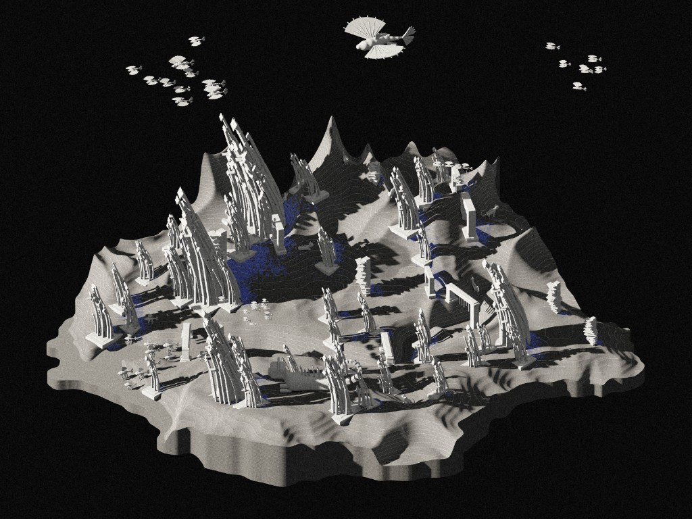

# Shadow Ecology — Visual Direction

> What could the world look and feel like? Exploratory imagery, morphology, references and research.
> Related: [Shadow Ecology planning](shadow-ecology.md) (concept, systems, 0.3 status, [Precedent Research](shadow-ecology.md#precedent-research)) · [Living Architecture experiments](../analysis/living-architecture-experiments.md) · [Style Guide](../../STYLE-GUIDE.md) (execution and design-system rules)

---

## Direction

**The world blurs architecture, organism, geology and scientific model.** Organisms should feel derived from the same procedural, formal language as the landscape and structures, not like conventional animals placed into the scene.

> **Exploratory, not implemented.** Visual and concept research for future development. Nothing here is committed Prototype 0.1 functionality. How organisms take part in the ecology is a system question, kept under [Organisms](shadow-ecology.md#organisms) in the planning document.
>
> **Status in 0.3.** Living Architecture morphology is now being explored in the app (see [Living Architecture experiments](../analysis/living-architecture-experiments.md)); creatures, the wetland patch and the vocabulary below remain exploratory.

## Concept Visuals

> **Concept visualization, not a screenshot.** A visual reference for the world's direction, not the current Prototype 0.1 implementation.

## Living Architecture: Scale and Legibility

**A priority of the current phase (0.3).** Concept and mechanism are in [Shadow Ecology planning](shadow-ecology.md#living-architecture); this section is about how it should look and read. Which growth representation will produce it is **not decided**; results so far are in [Living Architecture experiments](../analysis/living-architecture-experiments.md).

**The problem in 0.2.** The scale and visual identity of the structures were ambiguous. It was hard to tell whether an individual block was a living unit, a plant or part of a building.

**To investigate** (open, not decided):
- **Three readable levels:** living units, complete architectural organisms, and larger landmark-scale structures. They should be told apart without assuming the final design is block-based.
- **Scale against everything else:** terrain, water, vegetation, creatures and the Explore camera.
- **Architectural qualities:** spatial enclosure, structural spans, supports, negative space, and shadow coverage that means something.
- **Silhouette:** forms that stay legible in Overview, Approach and Explore.

**Target morphology (0.3 brief).** One or two dominant masses with a clear hierarchy of secondary growth; asymmetric, interlocking volumes at different heights and orientations; thick, layered tissue with irregular growth edges; openings, overhangs and partly enclosed spaces that come from growth and recession; visible difference between active, mature and senescent tissue; a biological identity without tree-like branching, repeated modules or human-designed doors and windows. The direction is called *Interlocking Living Strata* (a hybrid, stratified geometric language). Its architectural and natural references, and how far each has been studied, are in [Precedent Research](shadow-ecology.md#precedent-research). Not yet shown: a side-by-side of approaches at matched ages (see the experiments' evidence list).

**Scale and resolution (to validate).** The three readable levels above have not been tested against the 0.3 island scale. What the grids used so far can resolve (1.5 m voxels, 0.8 m fields, coarse forms) at Overview, Approach and Explore is an open check, not a result.

**References.** Treat 0.2 as a selective visual reference, not a blueprint to copy. Draw also on the repository's existing visual materials (the concept visualization above and `docs/images/`) and the project's Are.na visual reference collection.

## Ecological Inspirations

Exploratory. Mechanism and open questions are in [planning](shadow-ecology.md#ecological-inspirations-exploratory).

**Qingshan Lake water forest (Hangzhou)** as a possible wetland micro-biome:
- trees emerging from shallow flooded ground
- floating aquatic vegetation such as duckweed
- waterbirds, including swans and young swans, interacting with aquatic plants
- a possible contrast between cobalt-blue open water and green, vegetated shallows

A reference for one patch, not a decision to reproduce the lake or make the whole island a green wetland. Cobalt remains the colour of water (see [Style Guide](../../STYLE-GUIDE.md)).

## Realism and Fiction

Terrain, water and soil can aim to look like the natural processes behind them. Living Architecture, shadow-dependent organisms and some creatures may be fictional. Both should share one **coherent sculptural visual language**, so a realistic hill and an invented structure read as parts of the same world. This extends the direction above: organisms and structures derive from the landscape's formal language.

## Visual & World Vocabulary

**Form / motifs**\
circle · ring · ripple · shell · eye · bubble · river · branching · cross-section · layers · abstract geometry · maps · contour lines

**Material / landscape**\
stone · moss · water · river · wind

**Optical / representational**\
fisheye · telescope · scientific specimen · cross-section · black and white with restrained colour · analytical / cartographic overlays

**Organic references**\
fish / marine organisms · cat · bird · horse · swan

## Creature Explorations

Drawn from the concept visualization above. Directions, not fixed species. Cat, fish, bird and horse are sources of form, movement, behaviour and morphology, not literal species that must appear in the world.

| Direction | Hybrid of | Form and behaviour |
|---|---|---|
| **Light-fin creatures** | fish × bird | Fan-like radial fins or wings; airborne, oriented or migrating toward light |
| **Small perching light-fins** | light-fin variant | Rest on structural growths |
| **Stilt creatures** | fish × quadruped / cat | Elongated legs; aquatic body language translated onto land |
| **Shadow creatures** | cat × mineral | Faceted, prismatic bodies, segmented geometric tails, crystalline plates; associated with sheltered habitat |
| **Architecture-creature hybrids** | organism × structure | Larger organisms that host or grow structural forms on their bodies |

The intended direction is unfamiliar but plausible hybrids that borrow recognisable traits (especially from birds, fish, cats, horses and swans), never a literal combination of animal parts and never a finished species. Morphology and behaviour should follow the world's habitats, including shelter produced by architecture. Ecology side: [Organisms](shadow-ecology.md#organisms).

## Visual Research Keywords

Search terms for Are.na while developing the conceptual and visual direction.

| Theme | Search terms |
|---|---|
| **Ecology / organisms** | ecosystem engineers architecture animals · organisms building habitats · termite mound ecology architecture · shade adapted ecosystem · cave ecology · biological structures habitat · canopy microclimate |
| **Light / architecture** | self shading architecture · architecture shaped by solar shadow · negative space architecture shadow · light shadow architecture diagram · generative architecture growth |
| **Landscape / time / material** | material weathering architecture · landscape as archive · traces of time architecture · temporal landscape drawing · process drawing architecture |
| **Visual language** | speculative landscape drawing · architectural ecology diagram · geological section illustration · environmental data visualization landscape · scientific specimen visualization |
