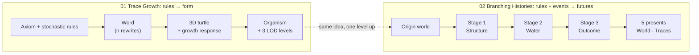
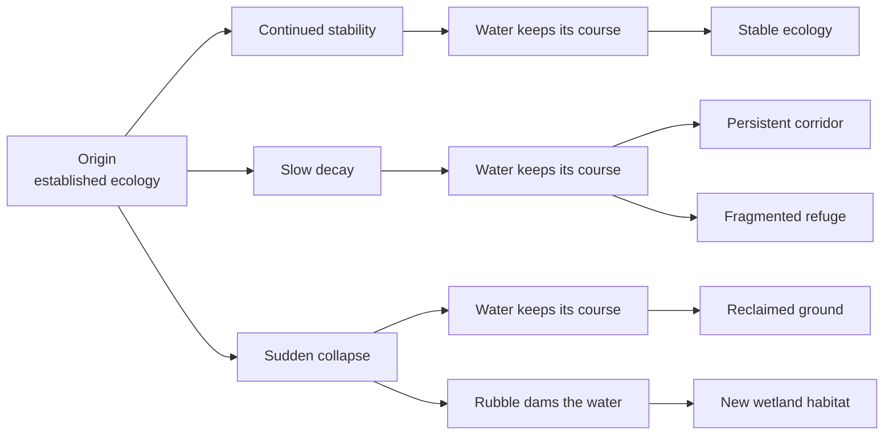

# Week 07 — Branching Systems

> Two studies on branching. **Trace Growth** asks how a few rules branch into *form*: a recursive L-system, read by a 3D turtle, grows beside a cantilevered slab. **Branching Histories** asks how rules and events branch into *futures*: one established world, run under the same ecological rules, splits into five different presents. Branching in space, then branching in time.

---

## Why It Matters

- **Branching is how procedural systems multiply.** A rule that replaces one thing with two, applied again and again, produces plants, rivers, networks and cracks. The same idea applied to *states* rather than shapes produces alternative histories.
- **Same rules, different outcomes.** Both studies are controlled experiments. Trace Growth keeps the grammar, seed and settings fixed and changes only how growth reads the environment. Branching Histories keeps the world and its rules fixed and changes only the events.
- **Form and history both stay readable.** Growth records its age and where it sheltered in its tone. Each history records what it lost or gained as traces on the ground.
- **Where it fits:** Week 06 *arranged* things in space. Week 07 lets them *grow* and *change*: rules → branching form → events → branching futures → traces. That is the vocabulary Shadow Ecology needs for growth, decay and memory.

---

## Core Concepts

| Concept | Meaning |
|---|---|
| **L-system** | A start word (the **axiom**) and rules (**productions**) that rewrite each symbol. Rewriting `n` times grows the word by generations. |
| **Apex (X) / internode (F)** | X is a growing tip the rules rewrite, never drawn. F is one drawn segment of stem. |
| **Stochastic rule** | A symbol with several possible successors, chosen by weight from a seeded random sequence. |
| **Turtle** | A cursor with a position and a frame (heading H, left L, up U) that reads the word left to right and draws it. `[` saves the turtle, `]` returns it to the fork. |
| **Tropism** | A bend toward a stimulus. Here it is a pull vector T, applied to each internode: toward the sun, or toward deep shelter. |
| **Shelter field** | 0 (open ground in full sun) to 1 (deep under the slab): 65% blocked sun, 35% blocked sky. |
| **Strahler order** | A branch rank: a twig is 1; where two limbs of equal order meet, the parent is one order higher. LOD uses it to decide what to keep. |
| **Level of detail (LOD)** | Several representations of one grown organism, drawn with fewer segments and sides as it gets further away. |
| **History node** | One simulated state of the world. Each node has its own world, metrics and the rule that made it. |
| **Regime** | How a history treats its world from that node on: the failure rate, scatter of rubble, and how creatures use their routes. |
| **Gated event** | A branch that only exists if its condition holds on the world the parent left (e.g. a dam needs rubble at the water). |
| **Trace** | Evidence a process leaves after it has stopped: former structure, rubble, lost shelter, routes walked or overgrown, dead vegetation, the old shore. |

---

## How It Works

### 1. Branching in space → branching in time



Week 07 opens on two tabs, **01 Trace Growth · 02 Branching Histories**. Both share About, LEARN, **H** to hide the UI and **R** auto-rotate. In Trace Growth one branch is one fork of a stem. In Branching Histories one branch is one possible future of a whole world. In both, the branching comes from rules applied to a state, not from authored variants.

### 2. Trace Growth: rules branch into form


*The default organism, fully grown under **Seek shelter**. It starts out in the sun beside the pier, sends runners along the ground and then fans out beneath the slab. Pale stems are fresh growth near the tips. Green stems are growth that has stayed in shelter long enough to be colonised. 62% of its internodes end in shelter.*

**The grammar.** Three runners leave the seed, and each apex is rewritten recursively:

```text
ω   [&&&X]/[&&&X]/[&&&X]
X → F/[+X][-X]     split     weight 1 at Randomness 0 → 0.36 at 1
X → F[&X]/F[&X]/X  fork      0 → 0.34
X → FX             runner    0 → 0.20
X → X              dormant   0 → 0.10
F → F              hold      1 → 0.60
F → FF             elongate  0 → 0.40
```

At **Randomness 0** only `split` and `hold` can fire, so every apex splits in two and the result is a strict fractal. Raising it blends in forks, creeping runners, dormant buds and elongating old internodes, and also jitters every turn and step (up to ±45% and ±35% at Randomness 1). `derive` expands each symbol depth first: `expand(X, n)` picks a successor and expands each of its symbols with `n − 1`. For a context-free grammar this gives the same word as rewriting the whole string `n` times. Rewriting stops past 90,000 symbols, so high iteration counts cannot run away.

**The turtle.** `+ −` yaw about U and `& ^` pitch about L, both by the branch angle. `/ \` roll about H by the golden angle (137.5°), so successive forks never line up and the form spirals into 3D. Each `F` steps forward and records a segment along with its parent, branch order, and **arrival** (path length from the seed). The ground and the slab deflect every response: a step that would go below ground creeps along the surface, and one that would enter the slab slides along its face.

**One word, three responses.** The grammar and the turtle use separate seeded random sequences, and neither depends on the response. So **Free**, **Seek light** and **Seek shelter** walk *the same word* with the same jitter. Only the tropism changes:

| Response | Pull T at each internode | Grows longer where |
|---|---|---|
| **Free** | none | (no change) |
| **Seek light** | toward the sun, scaled `0.28 + 0.72 · shelter` (hardest in shade) | lit |
| **Seek shelter** | toward the nearest deep-shelter ground point, scaled `1 − shelter`, plus a pull down onto surfaces once sheltered | sheltered |

Each internode turns about `H × T` by `min(1.2·|H × T|, 0.75)` rad. Its length is scaled by up to ±45% at full Tropism strength (±27% at the default 0.6), depending on whether it stands in the condition its response favours.


*Same grammar, seed and settings; different environmental response. The counts in the readout don't change (482 branches, 626 tips, 881 internodes), but the form does. Free sprawls around the seed. Seek light rises and leans toward the sun, with 2% of its internodes ending in shelter. Seek shelter creeps under the slab, with 62%.*

**Growth through time.** The organism is grown once and then revealed: a growth front advances along the arrival values, so every branch extends at the same speed and long runners finish last. The front narrows to a tip and is marked in red while it moves. A full run takes 9 s at 1× (0.5× and 2× are available), and Pause, Replay or the Growth slider scrub through it. Tone keeps time: fresh growth is pale bone, older growth weathers to grey, and growth that has stayed in shelter turns lichen green.

**LOD: Full / Reduced / Skeleton.** At a distance, a twig thinner than a pixel still costs triangles. Each organism therefore builds three representations from *the same internodes*. Changing level never regrows the organism, only draws less of it:

| Level | Keeps | Tube sides | Merges runs straighter than | Buds |
|---|---|---|---|---|
| **0 Full** | every internode | 8 | — | every apex |
| **1 Reduced** | limbs of Strahler order ≥ 2 | 5 | 12° | low-poly, on kept tips |
| **2 Skeleton** | only the top orders | 4 | 25° | none |

At every level, a kept limb continues along its **leader** (the child carrying the most tips) out to its final tip. This keeps each response's reach and lean, so Free, Seek light and Seek shelter still read as themselves at Skeleton. Radii follow the pipe model, `r = 0.0036 · tips^0.3`, and stay those of the full organism. **Auto** picks the level from the camera's distance to the target: Full nearer than 6, Reduced up to 9, Skeleton beyond, with a 0.3 hysteresis margin so the level doesn't flicker at a boundary.


*The same organism at the three levels, seen up close so the difference shows. Reduced drops the twigs off the main limbs and keeps 14% of the triangles. Skeleton keeps 2%, yet the runners, the fan under the slab and its outer reach are all still there. That is why Skeleton can stand in for Full at a distance.*

### 3. Branching Histories: rules and events branch into futures



The site is the Week 06 study terrain (massif, plain, basin lake and outlet), read on the Project's module lattice. On it stands a structure grown by the **Project's own architecture system** under the Project's sun, with shelter and exposure vegetation and 12 creatures in its shade. Every node in the tree is its own simulated copy of that world.

**Same underlying rules.** Every season of every history runs one `stepEcology`, in this order:

1. Any structural failure due this season.
2. Light through the architecture, then shade, shelter, moisture and habitat (shelter × moisture).
3. Both vegetation strategies grow toward their own suitability and spread from neighbours.
4. Creatures choose homes in the best habitat and walk least-cost routes to water. Walking wears paths, and unwalked wear fades and is grown over.
5. Peaks are recorded (the most shelter and wear each cell has had), so lost shelter and former paths stay measurable.

A branch never edits the outcome. It only changes the **regime** the rules run under, or applies a one-off event to the world.

**Stage 1: slow decay vs sudden collapse.** The first divergence is only *rate*. Both use one failure rule: each standing voxel is scored `0.45·open faces + 0.3·height + 0.4·unsupported + 0.35·random`, the top scorers fail, and any mass no longer connected to the ground falls with them. Fallen material lands outward from the structure, further the higher it fell and the faster the failure.

| Stage 1 | Regime | After the stage (10 seasons) |
|---|---|---|
| **Continued stability** | no failure (the control) | 181 voxels standing, 0 rubble |
| **Slow decay** | 3 voxels per season, scatter 0.35 | 151 standing, 28 rubble cells, the ruin still shades the shore |
| **Sudden collapse** | 150 voxels at once, scatter 0.8 | 20 standing, 110 rubble cells thrown wide, some into the lake |

**Causal consequences.** Later branches are gated: each rule exists only where its condition holds on the world its parent left.

- **Rubble dams the water** needs at least 8 rubble cells in or beside water. Sudden collapse throws enough into the lake; slow decay drops only a few blocks at the shore, so its history has no dam branch. The dam raises the water by 0.15 and floods up to 24 low cells near the rubble, drowning what grew there (water 86 → 109 cells).
- **Stage 3 outcomes** read how much shade survives compared with the origin. At ≥ 90% (and unchanged water) the result is **Stable ecology**. Between 40% and 90%, a world with enough worn path cells becomes a **Persistent corridor**, and one with enough rubble becomes a **Fragmented refuge**. Slow decay leaves 47% and qualifies for both. Below 40% the result is **Reclaimed ground**: collapse leaves 35%, so creatures leave. Changed water leads to **New wetland habitat**.

So there are 13 states and 5 presents. The tree is not a list of written stories: it is the set of futures these rules make possible from this origin.

![Week 07 Branching Histories at the Origin: on the left the history tree, with columns Origin, 01 Structure, 02 Water and 03 Outcome branching from Origin into Continued stability, Slow decay and Sudden collapse, then Water keeps its course or Rubble dams the water, and ending in five presents (Stable ecology, Persistent corridor, Fragmented refuge, Reclaimed ground, New wetland habitat); in the centre the Week 06 study block with a tall stepped graphite structure on the plain beside a cobalt lake, vegetation scattered over the pale terrain; on the right the panel describing the shared start](../images/week07/branching-histories-origin-tree.png)

*The shared origin, with the whole possibility space beside it. Clicking a node rebuilds the scene from that node's own simulated world. Hovering a node previews it, and the arrow keys walk the tree.*

![Two final presents side by side on the same study block: Stable ecology, from continued stability and water keeping its course, with the tall stepped structure still standing over the lake and dense shelter vegetation in its shade; New wetland habitat, from sudden collapse and rubble damming the water, with only a stump of the structure left, rubble scattered across the plain and into the lake, the water spread over the low ground at its edge, and vegetation crowding the new damp, rubble-strewn shore](../images/week07/branching-histories-stable-vs-wetland.png)

*One origin and one set of rules; two different presents. In the first the structure never failed. In the second it collapsed in one season, its rubble dammed the lake, and the flood made a damp, sheltered margin that did not exist before. Vegetation and creatures moved to the new shore.*

The five presents, measured:

| Present | Architecture | Shade | Rubble | Water | Creatures (pockets) | Worn · trodden · overgrown paths |
|---|---|---|---|---|---|---|
| *Origin* | 181 | 34 | 0 | 86 | 12 (2) | 2 · 0 · 0 |
| **Stable ecology** | 181 | 34 | 0 | 86 | 12 (1) | 4 · 0 · 0 |
| **Persistent corridor** | 122 | 16 | 48 | 86 | 12 (2) | 53 · 22 · 2 |
| **Fragmented refuge** | 93 | 15 | 60 | 86 | 12 (3) | 15 · 1 · 10 |
| **Reclaimed ground** | 20 | 12 | 110 | 86 | 0 | 0 · 0 · 26 |
| **New wetland habitat** | 20 | 3 | 99 | 109 | 12 (1) | 17 · 0 · 3 |

The corridor and the refuge share the same parent and differ only in how creatures use the ground. In the corridor, every creature walks the one worn route and tramples it bare (22 cells). In the refuge, creatures spread over three pockets and the old route is grown over.

**Persistent traces.** **World (W)** shows what exists now. **Traces (T)** dims the present and draws how it came to be: the former structure as wire boxes, rubble, ground that lost its shelter, every route walked (trodden corridors widest, overgrown ones in the vegetation's colour), dead vegetation and, where the water spread, the shore it had before.


*The wetland present read as evidence. The structure that stood is still legible as an outline, the rubble that caused the flood lies where it fell, and the old shore is drawn inside the new water. None of it is a stored animation: each mark comes from state the simulation kept, such as the cells ever built, peak shelter, peak wear and the earlier water.*

### 4. LEARN

Each tab has its own **LEARN** tour, in the same format as Weeks 05 and 06: a short explanation, the real control or scene outlined, a **Try** and a **Notice**.

| Tour | Steps | Path through the ideas |
|---|---|---|
| Trace Growth | 8 | Grammar: X and F → recursion → 3D turtle → Free → Seek light → Seek shelter (one seed throughout) → growth through time → level of detail |
| Branching Histories | 7 | One world, many histories → shared rules → different rates → consequences create branches → ecology responds → read the evidence → compare the presents |

---

## Implementation

### Key Files

| File | Role |
|---|---|
| `app/src/weeks/week07/BranchingSystemsWeek.tsx`, `StudyTabs.tsx`, `ViewStrip.tsx` | The page, its two subtabs, the view tools and **H** hide UI |
| `app/src/weeks/week07/lsystem.ts` | `TRACE_GRAMMAR`, `derive` (recursive, stochastic rewriting), `mulberry32` |
| `app/src/weeks/week07/turtle.ts` | `growTrace`: the 3D turtle, tropism, collisions, segments with arrival and pipe-model tips |
| `app/src/weeks/week07/environment.ts` | The slab and pier, the fixed sun, `shelterAt`, `lightBias`, `shelterBias`, `obstacleNormal` |
| `app/src/weeks/week07/traceMesh.ts`, `traceMaterial.ts` | Strahler order, leaders and the three LOD builds; the growth-front reveal and the fresh / aged / lichen tone |
| `app/src/weeks/week07/TraceGrowthStudy.tsx`, `TraceGrowthScene.tsx` | Panel, growth clock, Auto / Manual LOD, field and tropism overlays |
| `app/src/weeks/week07/histories.ts` | `HISTORY_RULES` (stages and conditions), `buildHistoryTree`, `describeChange` |
| `app/src/weeks/week07/historyWorld.ts` | `World`, `Regime`, `stepEcology`, `failVoxels`, `damWater`, `measure` |
| `app/src/weeks/week07/site.ts`, `architecture.ts` | The Week 06 terrain on the Project's module lattice; the origin structure grown by the Project's architecture system |
| `app/src/weeks/week07/vegetationLayout.ts`, `plantForms.ts` | Plant placement by Week 06 Distribution's Environment pipeline; the Project's botanical forms |
| `app/src/weeks/week07/BranchingHistoriesStudy.tsx`, `HistoryTree.tsx`, `HistoryWorldScene.tsx`, `worldMeshes.ts`, `historyColors.ts` | Panel and measures, the tree, World / Traces rendering with the Project's materials |
| `app/src/weeks/week07/learnSteps.tsx`, `historyLearnSteps.tsx` (+ `*LearnFigures.tsx`) | The two LEARN tours and their figures |

### Key Logic

**`derive`**: a rule is drawn by weights blended between Randomness 0 and 1, and every symbol of its successor is expanded one level shallower.

```ts
const expand = (symbol: string, depth: number) => {
  const rules = grammar.rules[symbol]
  if (depth === 0 || !rules) { out.push(symbol); return }
  const rule = chooseRule(rules, randomness, rng)
  for (const next of rule.successor) expand(next, depth - 1)
}
```

**Tropism in `growTrace`**: the response only adds a pull. The word and the random sequence stay the same.

```ts
const bias = responseBias(response, turtle.position, shelter).multiplyScalar(settings.tropism)
const axis = new Vector3().crossVectors(turtle.heading, bias)
rotateFrame(turtle, axis.divideScalar(axis.length()), Math.min(TROPISM_GAIN * axis.length(), TROPISM_MAX_TURN))
```

**`keptInternodes`**: a level keeps limbs of high enough Strahler order, and always the leader of a kept parent, so every kept limb runs out to its tip.

```ts
if (parentKept && (order[i] >= Math.min(lowest, top) || leader[s.parent] === i)) kept[i] = 1
```

**`grow` in `histories.ts`**: a child clones its parent's world, applies its event, runs the shared rules under its regime, then offers only the next-stage rules whose conditions hold.

```ts
const world = cloneWorld(parent.world)
rule.event?.(world)
runStage(world, { ...parent.regime, burst: 0, ...rule.regime }, STAGE_STEPS[rule.stage], seed)
node.children = HISTORY_RULES.filter((r) => r.stage === rule.stage + 1 && r.when(node, origin)).map((r) => grow(node, r, origin))
```

### Parameters / Controls

**Trace Growth:**

| Parameter | Default / Range | Effect |
|---|---|---|
| Iterations | 7 · 1–8 | Rewrites of the axiom; apexes roughly double each time |
| Branch angle | 30° · 5–70° | Yaw and pitch turn: narrow gives veins and runners, wide gives coral fans |
| Step length | 0.15 · 0.05–0.3 | Length of one internode |
| Randomness | 0.55 · 0–1 | Strict fractal at 0; forks, runners, dormant buds, elongation and jitter above |
| Seed | 7 · 1–999 | Rule choices and jitter |
| Growth response (keys **1–3**) | Seek shelter · Free / Seek light / Seek shelter | What the turtle reads at every internode |
| Tropism strength | 0.60 · 0–1 | How hard the response bends and lengthens growth (unused in Free) |
| Shelter / Light field · Tropism vectors | off | The field the response reads, contoured at 0.5 and 0.8; the pull at each internode |
| Growth | Play / Pause (**Space**) · Replay · 0.5× / 1× / 2× · slider | The growth front, 9 s at 1× |
| Detail | Auto · Auto / Manual · 0 Full / 1 Reduced / 2 Skeleton | Auto switches at camera distance 6 and 9 |

**Branching Histories:**

| Control | Effect |
|---|---|
| History tree | Hover to preview, click to build a node's world; **← →** parent / child, **↑ ↓** sibling |
| View (**W** / **T**) | World: what exists now. Traces: the evidence of how it came to be |
| Measures | Each value against the most any history reaches; the tick marks the parent's value |
| Rules · How it works | The ecological rules every season runs, and each stage's conditions |

**Shared:** **H** hide UI, **R** auto rotate, **F** wireframe (Trace Growth), **LEARN**, drag to orbit, scroll to zoom. Trace Growth also has Reset / Save / Load page snapshots.

---

## Experiments & Observations

| Tried | Observed | Why |
|---|---|---|
| Switching Free → Seek light → Seek shelter | 482 branches, 626 tips and 881 internodes in all three; 3% / 2% / 62% sheltered | The word and the jitter don't depend on the response, so the comparison is controlled |
| Manual LOD on the default organism | Full 64.2k triangles · Reduced 9.1k (14%) · Skeleton 1.3k (2%) | Twigs are most of the internodes but carry little of the silhouette; leaders keep the reach |
| Comparing Slow decay with Sudden collapse | 151 vs 20 voxels standing, 28 vs 110 rubble cells after Stage 1 | One failure rule at two rates; faster failure also throws rubble further |
| Looking for a dam under Slow decay | No dam branch exists | Too little rubble reaches the water, so the gate (≥ 8 cells) never opens |
| Slow decay → Water keeps its course | Two outcomes from one parent: corridor and refuge | 47% of the origin's shade, 8 worn path cells and 48 rubble cells satisfy both conditions |
| Reclaimed ground in Traces | 26 overgrown path cells, 0 creatures | Creatures left once shade fell below 40%; unwalked wear fades and vegetation grows over it |

---

## Connection to Shadow Ecology

Week 07 is a study, not a module of the Project. It does reuse the Project's parts: Branching Histories grows its origin structure with the Project's architecture system, light and sun, and draws it with the Project's materials and palette. Trace Growth's tones are the Project's path, weathered-architecture and habitat colours.

| Week 07 idea | In Shadow Ecology 0.1 | Possible later use (not implemented) |
|---|---|---|
| **Rules branch into form** | Architecture already grows by a weighted grammar of moves (rise, wall, terrace, cantilever, span, opening) chosen by the sun | An organism that occupies habitat and seeks light or shelter, recording age and shade in its material |
| **Same rules, different futures** | Deterministic: the same settings and time give the same world | Comparing runs that differ by one event or rate, to see which consequences the rules allow |
| **Slow decay vs sudden collapse** | Weathering wears old, open, poorly supported modules gradually | Failure at different rates, with fallen material that changes shelter or water |
| **Persistent traces** | Shelter is remembered for about four days; paths are rebuilt each sunset and leave no trace | Paths that wear and fade, and evidence (rubble, former shade, old shores) that later processes can read |

These later uses are the candidates listed under *Project 0.2 direction* in the [Shadow Ecology planning notes](../planning/shadow-ecology.md#project-02-direction). They are options, not features. The most transferable lesson is the gate: an event becomes possible only when the world it acts on allows it. That keeps a branching system causal rather than scripted.

---

## Takeaways

- **Now I understand:**
  - An L-system is recursion plus interpretation. The grammar only decides topology; the turtle decides where it goes, and the environment can bend the turtle without touching the grammar.
  - Separate random streams make a fair experiment: the grammar draws from one and the turtle from another, so changing the response cannot change the word.
  - LOD should follow structure, not distance alone. Ranking branches by Strahler order and always keeping leaders preserves the silhouette at 2% of the triangles.
  - A history tree is a possibility space when branches are conditions on state, not authored steps. The same rules then explain every present.
- **Surprised by:**
  - How different Free, Seek light and Seek shelter look, given identical branch and tip counts.
  - That *rate* alone (3 voxels per season vs 150 at once) decides whether the water is ever dammed.
  - How much a world can say about its past once peaks are recorded (peak shelter, peak wear, cells ever built).
- **Limitations:**
  - The grammar is context-free: branches don't sense each other, so they can cross or crowd.
  - Trace Growth's environment is one slab and a fixed sun; the organism doesn't change its own shelter field.
  - The history tree has three fixed stages and a hand-written set of events; it is simulated once when the study opens.
  - Only some traces act on the world: worn ground eases walking, and rubble shelters, keeps ground damp and can dam the water. The rest of the evidence (former structure, lost shelter, the old shore) is only drawn.
- **Next:**
  - Let growth read its own shade (context-sensitive or space-colonising growth).
  - Let recorded evidence, such as lost shelter or the old shore, become an input to later stages.
  - Try one of the branching ideas inside Shadow Ecology, with a single event and a single trace.

---

## References

### Course

- Week 07 lecture / material: branching systems — L-systems and recursion, turtle interpretation, stochastic variation, branching histories and possibility spaces

### External

- [Prusinkiewicz & Lindenmayer: The Algorithmic Beauty of Plants](http://algorithmicbotany.org/papers/#abop): L-systems, bracketed and stochastic grammars, and 3D turtle interpretation with tropism
- [L-system](https://en.wikipedia.org/wiki/L-system): axiom, productions and parallel rewriting
- [Turtle graphics](https://en.wikipedia.org/wiki/Turtle_graphics): the drawing cursor behind the interpretation
- [Strahler number](https://en.wikipedia.org/wiki/Strahler_number): the branch ranking used to choose what each LOD level keeps
- [Disturbance (ecology)](https://en.wikipedia.org/wiki/Disturbance_(ecology)): why the rate and scale of a disturbance shape what follows
- [Path dependence](https://en.wikipedia.org/wiki/Path_dependence): how early events constrain which futures remain possible
