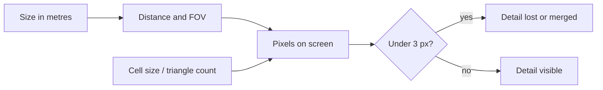
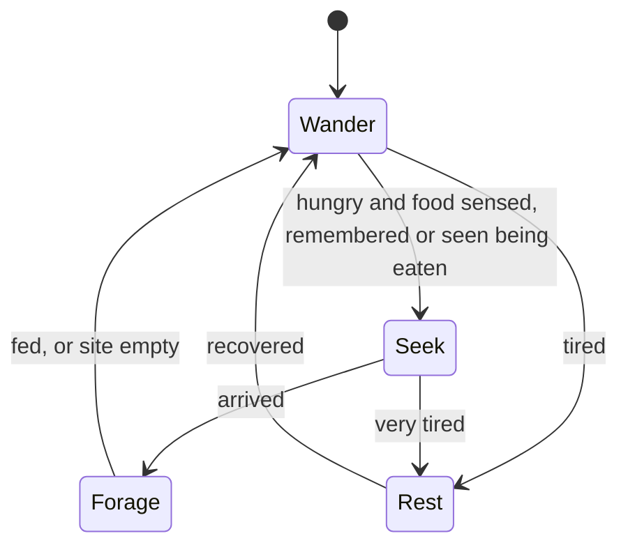

# Week 08 — Agents & Scale

> Two studies: **Scale** asks how big things are, how big they *look*, and how much detail a view can use. **Agents** asks how inhabitants perceive, decide and leave marks, and how paths emerge from that. Both are complete and independent of Shadow Ecology 0.3.

---

## Why It Matters

- **One working scale.** 1 unit is 1 metre everywhere. Without it, a person, a 3 cm wing and a 38 m organism cannot be compared, and resolution cannot be chosen.
- **Looking big is not being big.** Distance and lens decide size on screen; resolution decides what survives; the camera decides whether either is seen.
- **Where it fits:** Shadow Ecology 0.3 has a 4.1 km island, a walker at 1.75 m, and three cameras (Explore, Approach, Overview). Scale is the lens for choosing grid, mesh and LOD for Architecture, Vegetation and Creatures.

---

## Core Concepts

| Concept | Meaning |
|---|---|
| **Working scale** | 1 unit = 1 m. A person (1.75 m) is always available to read against. |
| **Apparent size** | Pixels = size ÷ (2 · distance · tan(FOV/2)) × view height. Twice the distance, half the size. |
| **Field of view (FOV)** | The lens. Narrow magnifies and flattens depth; wide shrinks the subject and stretches depth. The camera does not move. |
| **Dolly zoom** | Moving the camera as the FOV changes so distance × tan(FOV/2) stays constant: the subject keeps its size, its surroundings do not. |
| **Sampling resolution** | The cell size of a grid. A cell is solid if its centre is inside, so features thinner than a cell are lost. |
| **Mesh resolution** | The triangle count describing a curve. Coarse meshes show facets on the silhouette. |
| **Screen-space resolution / LOD** | The pixels a feature gets at a given distance. It should decide the other two: detail finer than a pixel is not seen. |

---

## How It Works

The same object is sampled at a chosen cell size or built at a chosen triangle count, then viewed through a distance and a lens. Only the pixels it gets decide what is seen.

---

## Implementation

### Key Files

| File | Role |
|---|---|
| `app/src/weeks/week08/scale.ts` | Pure maths and data: metre-scale objects, apparent pixels, dolly distance, voxelising, ring mesh levels and edge error |
| `app/src/weeks/week08/ScaleScene.tsx` | Scene: objects at true size, cells, ring test piece, depth poles, camera rig (applies the dolly) |
| `app/src/weeks/week08/ScaleStudy.tsx` | Panel: Object, Camera, Resolution, Reference, ruler; readout |
| `app/src/weeks/week08/learnSteps.tsx` | Eight-step Learn tour with presets |

The exercise copies the 0.3 constants (island 4096 m, eye 1.75 m, LA-01 about 38 m, voxel 1.5 m, field 0.8 m, camera 46°); it does not import the project.

### Parameters / Controls

| Control | Range | Effect |
|---|---|---|
| Object (1–5) | person, creature, shade shrub, spire plant, LA-01 | Which proportional stand-in is the subject |
| Distance | 1.5 m – 3.5 km (log) | Size on screen |
| Field of view | 20° – 90° (presets 20°, 46°, 90°) | Magnification and depth |
| Dolly zoom, Sweep, Depth poles | toggles | Camera moves with the lens; the FOV oscillates; sage pole in front, clay pole behind |
| Form | Smooth / Cells / Mesh | Geometric reference, grid sampling, or the ring test piece |
| Cell size | about 3% – 33% of the object | Sampling resolution |
| Mesh detail | Low 80 / Medium 480 / High 4,608 triangles | Geometric resolution of the ring |

*Smooth* is the model's own geometry, finely tessellated: a reference, not infinite resolution.

---

## Experiments & Observations

Labels: **Computed** follows from the maths (800 px tall view); **Observed** was seen in the app; **Provisional** rests on an assumed size.

| Tried | Expected | Result | Label |
|---|---|---|---|
| Dolly zoom on, FOV 90° → 20° (LA-01, 38 m, from 95 m at 42°) | Subject holds its size | Subject 52.1% of the view at every FOV (camera 36 → 207 m); foreground pole 147% → 31%, background pole 8% → 19% | Computed |
| Same FOV sweep, dolly off | Subject changes | Subject 20% → 113% | Computed |
| Dolly in the app, FOV 20° / 46° / 90° | Subject constant | 20% at all three; foreground 15% / 18% / 34%, background 11% / 9% / 6% | Observed |
| 1.5 m cell at 46° | Grid visible only near | 64 px at Explore (22 m), 6.4 px at Approach (220 m), 0.5 px at Overview (2.6 km): blocks, grain, invisible | Computed |
| Cells 0.25 m on the creature | Thin wings suffer | The 3 cm wings vanish, the body stays; they return only near 3 cm | Observed |
| Ring at Low / Medium / High, from 95 m | More triangles, better edge | Edge error 15 / 2.4 / 0.4 px; from 2.6 km Low is 0.6 px, so all three look alike | Observed |
| Smallest feature that stays 3 px at 46° | Grows with distance | 7 cm (Explore), 70 cm (Approach), 8.3 m (Overview) | Computed |
| A 3-px range for a 9 m spire, a 2 m shrub, a 3.3 m wingspan | Taller things read from further | About 2.8 km, 630 m and 1.0 km | Computed; sizes provisional |

Earlier weak effect of the dolly zoom was a missing-depth-cue problem, not a maths error: with nothing near or far in the frame there was nothing to change. The two poles and a three-row meter fixed it.

---

## Agents Study

A seeded world of agents on a 96 m patch (64 × 64 cells of 1.5 m, the 0.3 voxel size), with terrain, water, rocks, three shade slabs and six food sites. Each agent is a four-state machine that senses only what lies within its perception radius, and every agent writes to and reads from one shared trail field.

| Mechanism | Rule |
|---|---|
| **Perception** | Within radius R: nearest food site with food left, nearest shade, water and rocks ahead, neighbours (separation; a neighbour foraging is a pointer to food), trail at three sensors ahead. Outside R, only remembered sites: the last food eaten and the last shade rested in. |
| **Needs** | Energy falls while moving and is refilled by foraging; tiredness rises while moving, faster in open sun than in shade, and falls only under a slab. |
| **Stigmergy** | Each step an agent adds trail to its cell: 0.12, six times that after a meal (for 40 s), three times that when heading for food. Trail then decays (half-life set by Trail persistence) and spreads 10% to its neighbours. Wandering agents turn toward the strongest of three sensors, scaled by Trail attraction. |
| **Determinism** | One seeded random stream, a fixed 0.1 s step, no dependence on frame rate. Terrain, water, rocks, shade, food and start positions all come from the seed. |

### Key Files

| File | Role |
|---|---|
| `app/src/weeks/week08/agents.ts` | Pure simulation: world and lakes, three species' state machines, perception, trail and nutrient fields, metrics, same-seed comparison |
| `app/src/weeks/week08/AgentsScene.tsx` | Heightfield with a trail texture, landmarks, instanced agents coloured by state, perception ring, fixed-step runner |
| `app/src/weeks/week08/AgentsStudy.tsx` | Panel, readouts, inspection of one agent |
| `app/src/weeks/week08/agentLearn.tsx` | Six-step Learn tour with presets and a state-machine figure |

### Controls

| Control | Range | Effect |
|---|---|---|
| Terrestrial, Aerial, Aquatic, Run, Seed | 0–80 each; Mixed or one kind; 1–99 | Agents of each kind; which are present; which patch (any change restarts the run) |
| Perception | 2–20 m (default 8) | The ring in which an agent senses food, shade, hazards, neighbours and trail |
| Movement speed | 0.5–4 m/s (1.5) | Walking speed on level ground; slopes, tiredness and starvation slow it |
| Trail persistence | 5–120 s (40) | Half-life of the trail |
| Trail attraction | 0–1 (0.6) | How strongly wanderers turn toward stronger trail; 0 is the control |
| Simulation speed, Pause, Reset | 0.5–8×; P; X | Same run at any speed |
| Trails, Perception | T, E | Show the trail on the ground; show the inspected agent's ring |

Click an agent to inspect its state, energy, tiredness, target and what it senses.

### Experiments & Observations

**Checked** in Node on the pure simulation (60 agents, seed 7, 300 s); **Observed** in the app.

| Tried | Result | Label |
|---|---|---|
| Same seed and settings, run twice | Identical checksums; a different seed gives a different one | Checked |
| State transitions | All four states are occupied throughout; over a 300 s run 15–29 wandering, 4–18 seeking, 0–4 foraging, 13–37 resting | Checked |
| Trail attraction 0.6 vs 0 | Share of all trail on the strongest 5% of cells: about 25% vs about 12% (spread evenly); food left 55% vs 45%, so following trails did not make foraging more efficient | Checked |
| Trails in the app, seed 7, 8× | After about a minute a bright route links two shade slabs and a food site around the pond; the share in the top 5% was 30–34% | Observed |
| Perception 3 / 8 / 20 m, trail attraction 0, three seeds, 300 s | Mean agents seeking or foraging 4.0 / 9.8 / 14.2; mean energy 0.18 / 0.36 / 0.37, so a wider ring finds food sooner, with diminishing returns past 8 m | Checked |
| Speed | 60 agents: 3,000 steps (300 s) in about 0.25 s in Node, so 8× is limited by the display, not the simulation | Checked |

First settings failed in two ways: agents spent most of their time resting and starving, and trails piled up around the shelters where agents start. Slower fatigue and hunger, a persistent "recently fed" trail, and giving every agent a remembered home shade fixed both.

### Multi-species extension

The terrestrial agents above are one of three behavioural archetypes (ground animal, bird, fish); they are not species designs. All three use the same four states, with different triggers, perception and layer.

| | Terrestrial | Aerial | Aquatic |
|---|---|---|---|
| Moves | Dry ground; slopes slow it; avoids water and rocks | 9 m above the surface, 2.2× speed; crosses water and rocks | Only inside its own connected body of water, 0.8× speed |
| Senses | Radius R: food, shade, hazards, neighbours, trail | 2.5 R (max 50 m): food, slabs; ignores trail | 0.75 R: algae and deep water in its own lake |
| Roam / Seek / Feed / Rest | Wander / seek food / forage / rest in shade | Fly / seek food / feed / perch on a slab | Swim / seek algae / graze / refuge in deep water |
| Tires or stresses | Moving, faster in sun | Flying | Shallow open water |

Interactions and feedback:

- **Shared food:** terrestrial and aerial agents eat at the same six food sites (indirect competition).
- **Nutrient field:** every agent adds nutrient where it is, most where it rests, perches or feeds. It spreads (also across the shore, as runoff), and fades.
- **It acts back:** nutrient speeds food regrowth at sites, speeds recovery in shelters and on perches, and sets how thick the algae in the lakes grows. That is the fish's food.
- **Controlled comparison:** Run comparison simulates the same seed four times (all together, then each kind alone, same counts, 120 s) without drawing it. Each kind has its own random stream, so a kind behaves the same alone unless something it shares has changed.

| Seed 7 (30 terrestrial, 16 aerial, 18 aquatic), second-half means | Mixed | Terrestrial alone | Aquatic alone |
|---|---|---|---|
| Food left | 94% | 99% | — |
| Habitat (nutrient near the slabs) | 0.29 | 0.20 | 0.00 |
| Aquatic energy | 81% | — | 59% |

Checked in Node over 1,500 steps on seed 7: no fish left its lake, no walker entered water or rock, and every bird stayed above the surface; two runs of one seed gave the same checksum. On seed 12 fish also did better in company (82% vs 60%), but the walkers starved (4%), so terrestrial results depend on the seed. Flocking and schooling were left out: nothing here needed them to show the comparison.

### Limitations

- The trail concentrates movement but does not reduce foraging cost here: the world is small and food is plentiful. A larger or sparser world would test that.
- Agents remember only their last food and shade; the rules, rates and thresholds are tuned for clarity, not ecology.
- Shade is a flat footprint under each slab. Species are archetypes: one body shape, one set of rates each. There is no predation, and no flocking or schooling.
- The nutrient rates, thresholds and 0.3–0.9 algae range are tuned so the effects are visible in two minutes, not measured from ecology.

### For Shadow Ecology 0.3 (not integrated)

- **Creatures:** ground, air and water archetypes sharing one state machine, driven by 0.3's own fields: shelter and shade from Living Architecture, light, moisture, terrain.
- **Paths:** trails from repeated walking could wear into the ground or steer where vegetation and shelter do well.
- **Ecosystem:** one rule set per archetype, with different needs and perception, sharing places and food, with a habitat field that activity writes and that feeds back on vegetation and shelter.

---

## Takeaways

Implications for Shadow Ecology 0.3:

1. **Proportional scale.** Work in metres. The person, LA-01 and the island are from 0.3's constants (computed). Creature, plant and LA-01 *sizes* are provisional: no creature or vegetation exists in 0.3 yet, and LA-01's form is under evaluation.
2. **Camera-dependent readability.** At the project's 46° camera, 1.5 m cells read as blocks at Explore, grain at Approach and not at all at Overview. Pick detail by the view that sees it.
3. **Right geometry per layer.**
   - *Architecture:* coarse grids are enough from Approach outward; refine only for Explore.
   - *Vegetation:* tall light-seeking spires read as landmarks from afar; low shade-spreading shrubs are close-range detail.
   - *Creatures:* 3 cm wings cannot live in a 0.8 m field; use meshes or instances, and cull by the distance at which they fall under 3 px.

- **Not validated:** none of this has been tested inside 0.3 itself. The 3 px threshold is a rule of thumb; the heights above are assumptions.
- **Limitations:** one test ring stands for all mesh detail; no real LOD switching; Smooth is the reference geometry only.
- **Next:** return to Architecture refinement, then carry the agent mechanisms into 0.3 creatures and paths.

---

## References

### Course

- Class 08 — Agents & Scale: working scale, perception of scale, state machines, perception and stigmergy.

### External

- Dolly zoom (the "Vertigo effect"): distance × tan(FOV/2) held constant to keep the subject's size.
- Stigmergy: coordination through traces left in the environment (Grassé's term for termite building; ant trails are the classic example).
